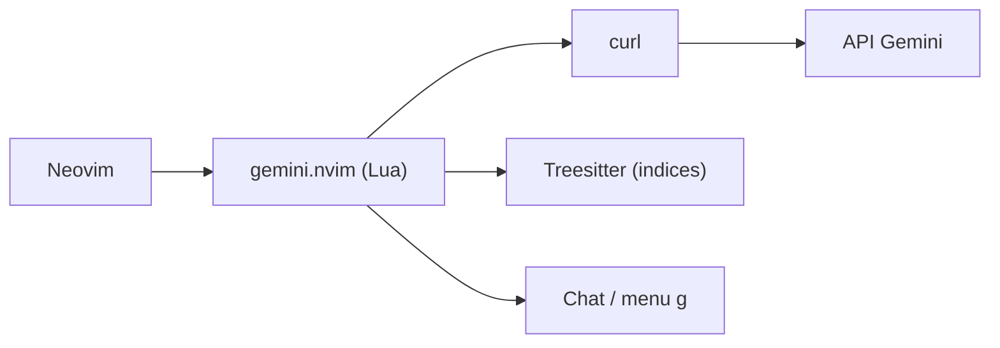

# kiddos/gemini.nvim

> Neovim plugin that connects Google's Gemini API to complete, explain, review and test code.

## The problem
Using an LLM in Neovim means copying code into a chat; this plugin calls Gemini from the editor.

## What it actually does
- Code completion, explanation, test generation, code review, hints and chat.
- Default model `gemini-2.5-flash`, prompts editable in Lua.
- "Task" mode: the content of all loaded buffers is sent with the request.
- HTTP calls via `curl`.

## How it is wired
Simplified diagram based on the sheet, no diagram provided.


## Trying it
```bash
sudo apt install curl
export GEMINI_API_KEY="<your API key here>"
```
```lua
{ 'kiddos/gemini.nvim', opts = {} }
```

## Cost and gotchas
Gemini API key at your expense. The project's code is sent to Google; the default blacklist excludes `.env` and a few formats. Task mode sends all open buffers.

## What it is not
Not an autonomous agent nor a multi-provider tool: Gemini only. The README's demo videos do not document privacy.

## Alternatives
No alternative mentioned in the README.

## For you
Ignore: single provider, a single maintainer, and open code sent to a third party; a more widespread editor assistant does better.
