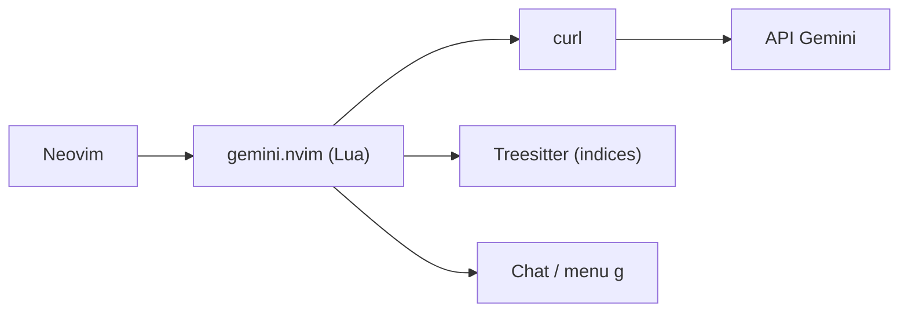

# kiddos/gemini.nvim

> Plugin Neovim qui relie l'API Gemini de Google pour compléter, expliquer, relire et tester du code.

## Le problème
Utiliser un LLM dans Neovim demande de copier du code vers un chat ; ce plugin appelle Gemini depuis l'éditeur.

## Ce que ça fait vraiment
- Complétion de code, explication, génération de tests, revue de code, indices et chat.
- Modèle par défaut `gemini-2.5-flash`, invites modifiables en Lua.
- Mode « tâche » : le contenu de tous les tampons chargés part avec la demande.
- Appels HTTP via `curl`.

## Comment c'est branché
Schéma simplifié d'après la fiche, sans diagramme fourni.


## Essayer
```bash
sudo apt install curl
export GEMINI_API_KEY="<your API key here>"
```
```lua
{ 'kiddos/gemini.nvim', opts = {} }
```

## Coût et pièges
Clé API Gemini à ta charge. Le code du projet est envoyé à Google ; la liste noire par défaut exclut `.env` et quelques formats. Le mode tâche envoie tous les tampons ouverts.

## Ce que ce n'est pas
Pas un agent autonome ni un outil multi-fournisseurs : Gemini uniquement. Les vidéos de démonstration du README ne documentent pas la confidentialité.

## Alternatives
Aucune alternative citée dans le README.

## Pour toi
À ignorer : mono-fournisseur, un seul mainteneur, et envoi du code ouvert à un tiers ; un assistant d'éditeur plus répandu fait mieux.

