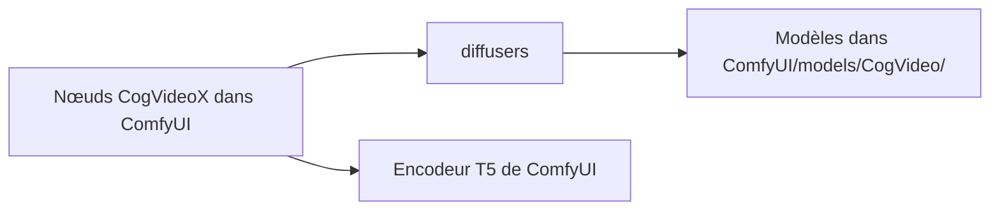

# kijai/ComfyUI-CogVideoXWrapper

> ComfyUI nodes for generating videos with CogVideoX, for those doing video in ComfyUI workflows.

## The problem
Using CogVideoX in ComfyUI requires integrating the models, quantizations and variants (Fun, Tora, DimensionX).

## What it actually does
Provides nodes for CogVideoX 5B (text to video, image to video, video to video), CogVideoX 1.5, Fun, Tora, LoRA, GGUF, FasterCache, sageattention, torchao quantization, torch.compile, Go-with-the-Flow. The VAE can be loaded separately. The README is an update log, with no installation guide.

## How it is wired
Simplified diagram based on the sheet, no diagram provided.

No diagram provided. Description based on the README: the nodes plug into ComfyUI, call diffusers, use ComfyUI's T5, and download the models into `ComfyUI/models/CogVideo/`.

## Trying it
No complete installation command in the README. Only commands for onediff appear:
```bash
pip install --pre onediff onediffx
pip install nexfort
```

## Cost and gotchas
GPU required: VAE decoding reaches 13-14 GB of VRAM. Update 8 broke all older workflows. Depends on specific diffusers versions.

## What it is not
Not a stable product: the README starts with "WORK IN PROGRESS". Last push in August 2025: video generation has moved on since. 153 open issues.

## Alternatives
Original repositories cited: THUDM/CogVideo, CogVideoX-Fun, cogvideox-controlnet.

## For you
Ignore: old, unstable and without documented installation; consult it only if you must reproduce an existing CogVideoX workflow.
