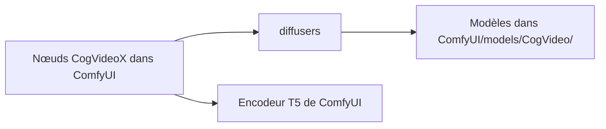

# kijai/ComfyUI-CogVideoXWrapper

> Nœuds ComfyUI pour générer des vidéos avec CogVideoX, pour qui fait de la vidéo en workflows ComfyUI.

## Le problème
Utiliser CogVideoX dans ComfyUI demande une intégration des modèles, quantifications et variantes (Fun, Tora, DimensionX).

## Ce que ça fait vraiment
Fournit des nœuds pour CogVideoX 5B (texte vers vidéo, image vers vidéo, vidéo vers vidéo), CogVideoX 1.5, Fun, Tora, LoRA, GGUF, FasterCache, sageattention, quantification torchao, torch.compile, Go-with-the-Flow. Le VAE peut être chargé séparément. Le README est un journal de mises à jour, sans guide d'installation.

## Comment c'est branché
Schéma simplifié d'après la fiche, sans diagramme fourni.

Pas de diagramme fourni. Description d'après le README : les nœuds s'insèrent dans ComfyUI, appellent diffusers, utilisent le T5 de ComfyUI, et téléchargent les modèles dans `ComfyUI/models/CogVideo/`.

## Essayer
Aucune commande d'installation complète dans le README. Seules figurent des commandes pour onediff :
```bash
pip install --pre onediff onediffx
pip install nexfort
```

## Coût et pièges
GPU nécessaire : le décodage VAE monte à 13-14 Go de VRAM. La mise à jour 8 a cassé tous les anciens workflows. Dépendance à des versions précises de diffusers.

## Ce que ce n'est pas
Pas un produit stable : le README commence par « WORK IN PROGRESS ». Dernier push en août 2025 : la génération vidéo a évolué depuis. 153 issues ouvertes.

## Alternatives
Dépôts d'origine cités : THUDM/CogVideo, CogVideoX-Fun, cogvideox-controlnet.

## Pour toi
Ignorer : ancien, instable et sans installation documentée ; ne le consulter que si tu dois reproduire un workflow CogVideoX existant.

