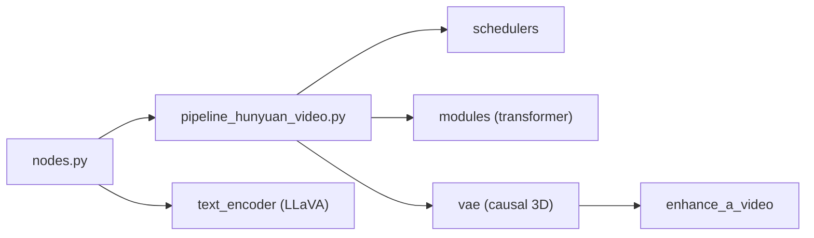

# kijai/ComfyUI-HunyuanVideoWrapper

> ComfyUI nodes for HunyuanVideo, today mostly useful for testing features missing from the native implementation.

## The problem
Running HunyuanVideo in ComfyUI before the native implementation existed, with memory optimizations and extra generation modes.

## What it actually does
A package of nodes (`nodes.py`, `nodes_rf_inversion.py`) that bundles the `hyvideo/` runtime: diffusion pipeline, transformer, schedulers (DPM-Solver, FlowMatch, SA-Solver, UniPC), LLaVA text encoder, causal 3D VAE and FP8 option. It adds IP2V (image as part of the prompt), official I2V, LoRAs, video inversion and Enhance-A-Video, with example workflows.

## How it is wired

## Trying it
The README gives no installation command. It lists the weight locations: ComfyUI's diffusion_models and vae, `ComfyUI/models/LLM/llava-llama-3-8b-text-encoder-tokenizer` and `ComfyUI/models/clip/clip-vit-large-patch14`.

## Cost and gotchas
Weights to download from Hugging Face. Memory depends on resolution and number of frames: the README warns not to aim high even with 24 GB. No license declared for the repository.

## What it is not
The author writes that he is almost stopping work on it, as ComfyUI's native implementation covers most of it. Still missing from the native one: context windowing, direct IP2V, manual memory management. Last push in August 2025, 299 open issues.

## Alternatives
- ComfyUI native implementation: covers most features.
- ComfyUI-HunyuanLoom: FlowEdit and Enhance-a-video natively.
- Comfy-WaveSpeed: FirstBlockCache and torch.compile with LoRA.

## For you
Ignore: the author has set it aside in favor of the native one, and the lack of a license makes any reuse risky.
