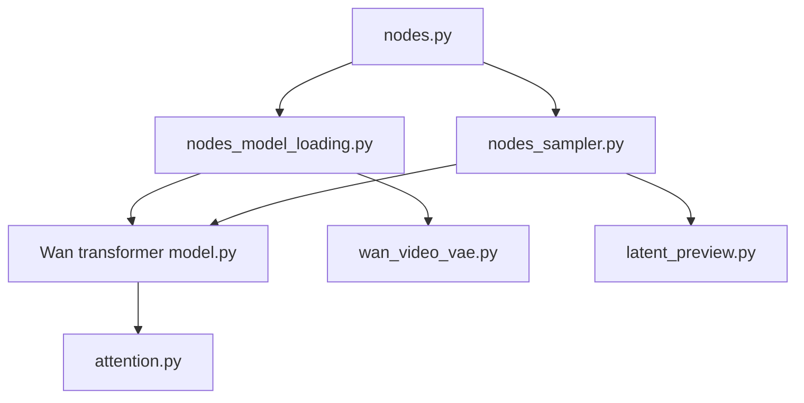

# kijai/ComfyUI-WanVideoWrapper

> ComfyUI nodes to quickly test WanVideo and related video models, for advanced users.

## The problem
New video models arrive faster than their native integration into ComfyUI.

## What it actually does
Adds to ComfyUI nodes to load a Wan transformer, sample the video and decode the latents, with preview. Supports GGUF, unmerged LoRAs, block swap, context windows and torch.compile. Integrates many neighboring models: SkyReels, VACE, MultiTalk, ATI, LongCat, etc. The author describes it as his sandbox, always a work in progress.

## How it is wired


## Trying it
```bash
# dans ComfyUI/custom_nodes
git clone <ce dépôt>
pip install -r requirements.txt
python_embeded\python.exe -m pip install -r ComfyUI\custom_nodes\ComfyUI-WanVideoWrapper\requirements.txt
```

## Cost and gotchas
Heavy GPU and VRAM needs, weights to download from Hugging Face. Unmerged LoRAs increase VRAM without block swap. Triton cache to purge on Windows. New accounts are blocked on issues.

## What it is not
Not a video generation service. Not an alternative to native workflows: the author says to use it only for a model or feature missing from the native nodes.

## Alternatives
ComfyUI's native nodes for WanVideo, recommended by the author himself unless you have a specific need.

## For you
Keep an eye on it: only if you do local video generation on a strong GPU; experimental code, 1,285 open issues, outside the data/MLOps core.
