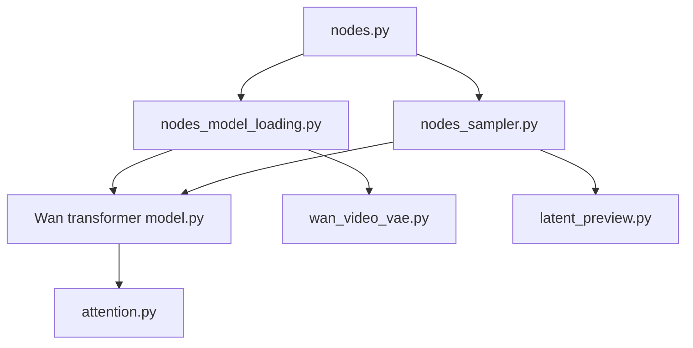

# kijai/ComfyUI-WanVideoWrapper

> Nœuds ComfyUI pour tester vite les modèles vidéo WanVideo et apparentés, pour utilisateurs avancés.

## Le problème
Les nouveaux modèles vidéo arrivent plus vite que leur intégration native dans ComfyUI.

## Ce que ça fait vraiment
Ajoute à ComfyUI des nœuds pour charger un transformer Wan, échantillonner la vidéo et décoder les latents, avec aperçu. Gère GGUF, LoRA non fusionnés, échange de blocs (block swap), fenêtres de contexte et torch.compile. Intègre de nombreux modèles voisins : SkyReels, VACE, MultiTalk, ATI, LongCat, etc. L'auteur le décrit comme son bac à sable, toujours en chantier.

## Comment c'est branché


## Essayer
```bash
# dans ComfyUI/custom_nodes
git clone <ce dépôt>
pip install -r requirements.txt
python_embeded\python.exe -m pip install -r ComfyUI\custom_nodes\ComfyUI-WanVideoWrapper\requirements.txt
```

## Coût et pièges
GPU et VRAM importants, poids à télécharger depuis Hugging Face. Les LoRA non fusionnés augmentent la VRAM sans block swap. Cache Triton à purger sous Windows. Nouveaux comptes bloqués sur les issues.

## Ce que ce n'est pas
Pas un service de génération vidéo. Pas une alternative aux workflows natifs : l'auteur dit qu'il ne faut l'utiliser que pour un modèle ou une fonction absente du natif.

## Alternatives
Les nœuds natifs de ComfyUI pour WanVideo, recommandés par l'auteur lui-même sauf besoin précis.

## Pour toi
À surveiller : seulement si tu fais de la génération vidéo locale sur GPU costaud ; code expérimental, 1 285 issues ouvertes, hors cœur data/MLOps.

