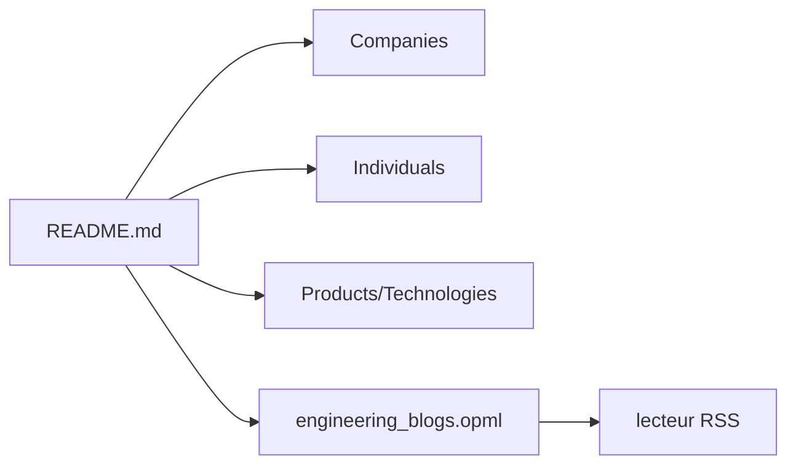

# kilimchoi/engineering-blogs

> Alphabetical list of engineering blogs from companies, individuals and technologies, to subscribe to via RSS.

## The problem
Technical experience reports from large teams are scattered across hundreds of sites. Finding them one by one takes a long time.

## What it actually does
A README that lists links, organized by companies (from 8th Light to Zendesk), individuals (Julia Evans, Dan Luu, Martin Fowler...) and products/technologies (Go, Rust, Kotlin...). An OPML file is provided to import the feeds into an RSS reader.

## How it is wired


## Trying it
```bash
# Aucune commande documentée : ouvrir le README,
# ou importer engineering_blogs.opml dans un lecteur RSS.
```

## Cost and gotchas
Free. Last push in August 2024: many URLs in the list (http, old domains, Medium) may be dead, and nothing in the README checks this.

## What it is not
Not an aggregator or a reader: just links. No data/AI topic selection, no guarantee that the feeds are active.

## Alternatives
No alternative named in the README.

## For you
Worth watching: useful as a reservoir of RSS sources, but it is an old general-purpose list without a license, which you must filter yourself for data/AI monitoring.
