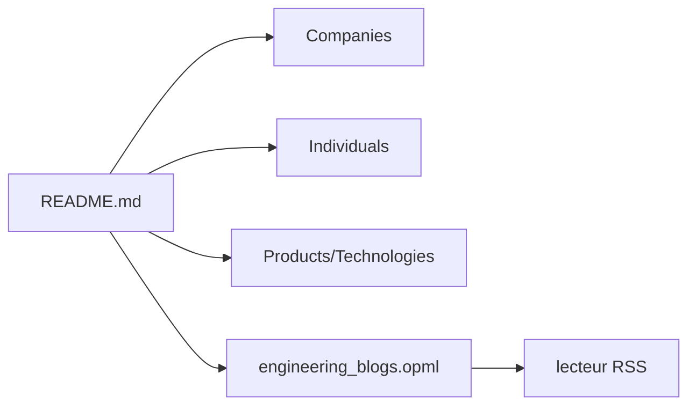

# kilimchoi/engineering-blogs

> Liste alphabétique de blogs d'ingénierie d'entreprises, de particuliers et de technologies, pour s'abonner en RSS.

## Le problème
Les retours d'expérience techniques des grandes équipes sont dispersés sur des centaines de sites. Les retrouver un par un est long.

## Ce que ça fait vraiment
Un README qui énumère des liens, rangés par entreprises (de 8th Light à Zendesk), individus (Julia Evans, Dan Luu, Martin Fowler...) et produits/technologies (Go, Rust, Kotlin...). Un fichier OPML est fourni pour importer les flux dans un lecteur RSS.

## Comment c'est branché


## Essayer
```bash
# Aucune commande documentée : ouvrir le README,
# ou importer engineering_blogs.opml dans un lecteur RSS.
```

## Coût et pièges
Gratuit. Dernier push en août 2024 : beaucoup d'URLs de la liste (http, anciens domaines, Medium) peuvent être mortes, rien dans le README ne le vérifie.

## Ce que ce n'est pas
Pas un agrégateur ni un lecteur : juste des liens. Aucune sélection par thème data/IA, aucune garantie que les flux soient actifs.

## Alternatives
Aucune alternative nommée dans le README.

## Pour toi
Surveiller : utile comme réservoir de sources RSS, mais liste généraliste ancienne et sans licence, à filtrer toi-même pour la veille data/IA.

