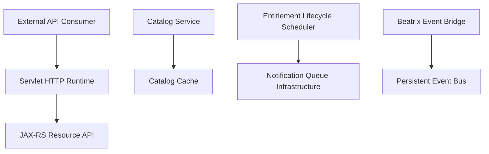

# killbill/killbill

> Open source subscription billing and payments platform, to self-host.

## The problem
SaaS billing services lock in your data and depend on a third party's availability; building it yourself takes a long time.

## What it actually does
Manages catalog, subscriptions, usage metering, invoices, payments through gateways, credits, taxes and dunning. A JAX-RS API server receives HTTP requests. Services drive the catalog and entitlements via persistent notification queues. Plugins connect payment gateways and tax engines.

## How it is wired

## Trying it
The README points to the "getting started" guide to run Kill Bill locally, without reproducing any command. Documentation at docs.killbill.io.

## Cost and gotchas
Free software, with no support or SLA. The Aviate offering (enterprise, level 3 support) is paid. To be hosted and operated yourself; database and gateways not specified in the sheet.

## What it is not
Not an all-in-one solution: modular, you have to plug in gateways and taxes. Not shipped with support.

## Alternatives
No alternative named in the README.

## For you
Worth watching: useful if you build an AI product billed by usage and want to keep your billing data, but heavy to operate.
