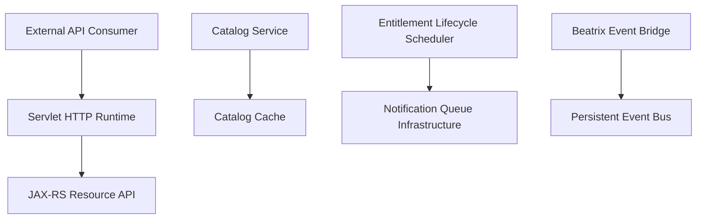

# killbill/killbill

> Plateforme open source de facturation d'abonnements et de paiements, à héberger soi-même.

## Le problème
Les services SaaS de facturation enferment les données et dépendent de la disponibilité d'un tiers ; le faire soi-même est long.

## Ce que ça fait vraiment
Gère catalogue, abonnements, mesure d'usage, factures, paiements via passerelles, crédits, taxes et relances. Un serveur d'API JAX-RS reçoit les requêtes HTTP. Des services pilotent le catalogue et les droits (entitlement) via des files de notifications persistantes. Des plugins connectent passerelles de paiement et moteurs de taxes.

## Comment c'est branché

## Essayer
Le README renvoie au guide « getting started » pour lancer Kill Bill localement, sans commande reproduite. Documentation sur docs.killbill.io.

## Coût et pièges
Logiciel gratuit, sans support ni SLA. L'offre Aviate (entreprise, support niveau 3) est payante. À héberger et exploiter soi-même ; base de données et passerelles non précisées dans la fiche.

## Ce que ce n'est pas
Pas une solution tout-en-un : modulaire, il faut brancher passerelles et taxes. Pas livré avec support.

## Alternatives
Aucune alternative nommée dans le README.

## Pour toi
À surveiller : utile si tu montes un produit IA facturé à l'usage et veux garder tes données de facturation, mais lourd à exploiter.

