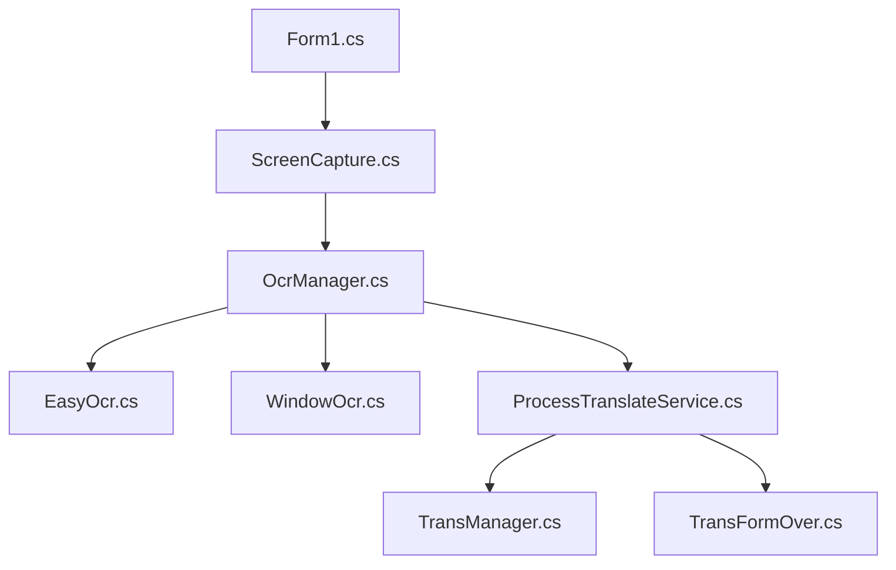

# killkimno/MORT

> Windows application that reads on-screen dialogue through OCR and translates it in real time, for gamers.

## The problem
Playing an untranslated game forces you to copy each line into a translator.

## What it actually does
It captures an area of the screen, passes it to an OCR engine (Tesseract, Windows OCR, Google Cloud Vision, EasyOCR, Snipping Tool) then translates via Papago, Google, DeepL, ezTrans or a custom HTTP API. The result is displayed in an overlay window. It handles multiple areas and a language patch via a database.

## How it is wired

## Trying it
No command: usage goes through the interface (set the OCR language, choose the area, click Translate).

## Cost and gotchas
Windows 10 or later, 64-bit, .NET 9 and the VC++ redistributable. A 32-bit version exists for CPUs without AVX2. Some translations require a third-party key or account. Fullscreen games do not work.

## What it is not
Not a cross-platform tool nor an OCR library. No fullscreen mode.

## Alternatives
For the custom translation, the README cites LibreTranslate and nllb-serve.

## For you
Ignore: a Windows gaming utility, with no use in a data / AI workflow.
