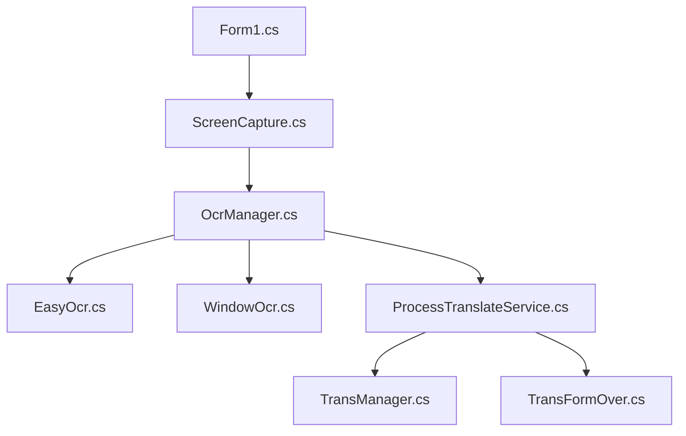

# killkimno/MORT

> Application Windows qui lit des dialogues à l'écran par OCR et les traduit en temps réel, pour joueurs.

## Le problème
Jouer à un jeu non traduit oblige à copier chaque ligne dans un traducteur.

## Ce que ça fait vraiment
Elle capture une zone de l'écran, la passe à un moteur OCR (Tesseract, Windows OCR, Google Cloud Vision, EasyOCR, Snipping Tool) puis traduit via Papago, Google, DeepL, ezTrans ou une API HTTP maison. Le résultat s'affiche dans une fenêtre superposée. Elle gère plusieurs zones et un patch de langue par base de données.

## Comment c'est branché

## Essayer
Aucune commande : l'usage passe par l'interface (régler la langue OCR, choisir la zone, cliquer sur Translate).

## Coût et pièges
Windows 10 ou plus, 64 bits, .NET 9 et VC++ redistribuable. Une version 32 bits existe pour les CPU sans AVX2. Certaines traductions exigent une clé ou un compte tiers. Les jeux en plein écran ne fonctionnent pas.

## Ce que ce n'est pas
Ce n'est pas un outil multiplateforme ni une bibliothèque d'OCR. Pas de mode plein écran.

## Alternatives
Pour la traduction maison, le README cite LibreTranslate et nllb-serve.

## Pour toi
À ignorer : utilitaire de jeu Windows, sans usage dans un flux data / IA.

