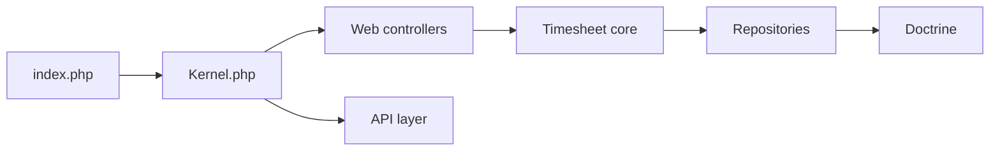

# kimai/kimai

> Free web application for time tracking with invoicing, for freelancers and companies.

## The problem
Track hours by client and project, then invoice, without a proprietary tool.

## What it actually does
Symfony/PHP monolith: timesheets (multi-timer, clock-in), customers, projects, activities, tags, teams, budgets, rates, reports, invoices, CSV/HTML/PDF/XLSX exports, JSON API, SAML/LDAP/2FA auth, plugins.

## How it is wired

## Trying it
No command in the README: it lists installation methods (Docker Compose, SSH/Composer, FPM or Apache images) that point to the documentation.

## Cost and gotchas
Free software; PHP 8.2+, MariaDB/MySQL, a dedicated domain name (no subfolder). Paid plugins and a cloud version exist.

## What it is not
Not a payroll tool nor full accounting software.

## Alternatives
No alternative cited in the README.

## For you
Worth watching: useful for self-hosted time tracking; no direct link to your field.
