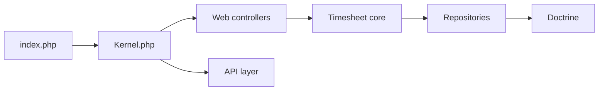

# kimai/kimai

> Application web libre de suivi du temps avec facturation, pour indépendants et entreprises.

## Le problème
Suivre les heures par client et projet, puis facturer, sans outil propriétaire.

## Ce que ça fait vraiment
Monolithe Symfony/PHP : feuilles de temps (multi-timer, pointage), clients, projets, activités, tags, équipes, budgets, tarifs, rapports, factures, exports CSV/HTML/PDF/XLSX, API JSON, auth SAML/LDAP/2FA, plugins.

## Comment c'est branché

## Essayer
Aucune commande dans le README : il liste des méthodes d'installation (Docker Compose, SSH/Composer, images FPM ou Apache) renvoyant à la documentation.

## Coût et pièges
Logiciel gratuit ; PHP 8.2+, MariaDB/MySQL, nom de domaine dédié (pas de sous-dossier). Plugins payants et version cloud existent.

## Ce que ce n'est pas
Pas un outil de paie ni de comptabilité complète.

## Alternatives
Aucune alternative citée dans le README.

## Pour toi
À surveiller : utile pour un suivi du temps auto-hébergé ; sans rapport direct avec ton métier.

