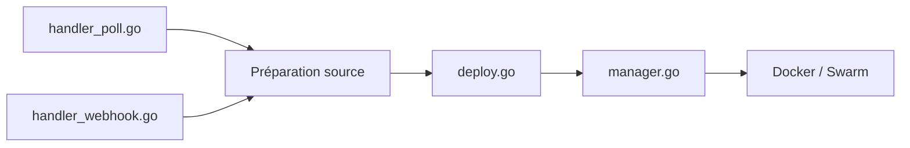

# kimdre/doco-cd

> Lightweight GitOps tool that deploys Docker Compose projects and Swarm stacks from Git, for self-hosters.

## The problem
Updating Compose files by hand across several hosts is repetitive; Portainer or ArgoCD are heavy for this need.

## What it actually does
Watches a Git repository (or an OCI artifact) by polling or webhook, prepares the source, then reconciles the deployment to Docker or Swarm. Handles external secrets and SOPS encryption, multiple hosts via Docker Contexts, sync windows, scheduled tasks, pre/post-deployment scripts, notifications and Prometheus metrics, with a REST API and an MCP server.

## How it is wired

## Trying it
The README documents no installation command: everything points to the documentation at doco.cd.

## Cost and gotchas
Free, low-footprint distroless image. Requires access to the host's Docker socket; configuration is in the external documentation, not summarized here.

## What it is not
Not a Kubernetes orchestrator: it targets Compose and Swarm. Not a graphical interface like Portainer.

## Alternatives
- Portainer and ArgoCD: cited as the references the tool simplifies.

## For you
Adopt if you deploy Compose from Git on your own server: active (push in September 2026), Apache-2.0, clear scope.
