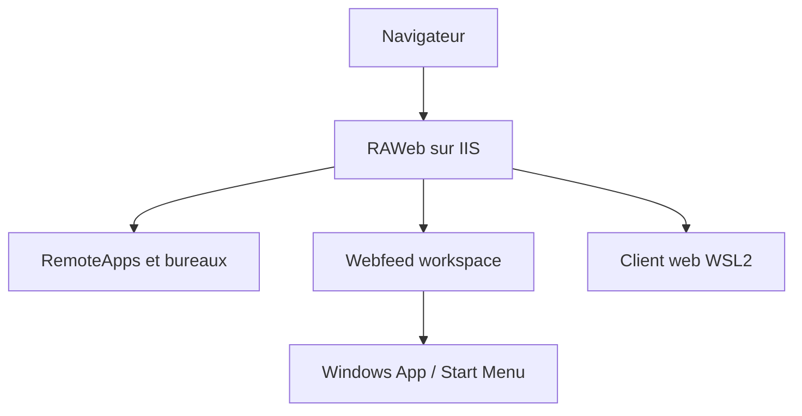

# kimmknight/raweb

> Web interface and workspace provider for Windows RemoteApps and desktops.

## The problem
Applications published through Remote Desktop Services have no modern web portal and no feed for Windows App clients.

## What it actually does
Lists, searches and sorts RemoteApps and desktops, lets you add or edit them, downloads RDP files or launches them. It exposes a "webfeed" for the Windows Start menu and mobile clients, with a web client via WSL2. Runs on IIS.

## How it is wired
Simplified diagram based on the sheet, no diagram provided.

## Trying it
Install with the installer from the latest release; default access at https://127.0.0.1/RAWeb. No commands in the README.

## Cost and gotchas
Free. Windows 10, 11 or Server only; installs IIS if missing. The web client requires WSL2.

## What it is not
Not a cross-platform remote desktop tool: it publishes existing Windows resources.

## Alternatives
No alternative named in the README (RemoteApp Tool is cited as a complement).

## For you
Ignore: remote Windows desktop administration, unrelated to a data / AI / MLOps job.
