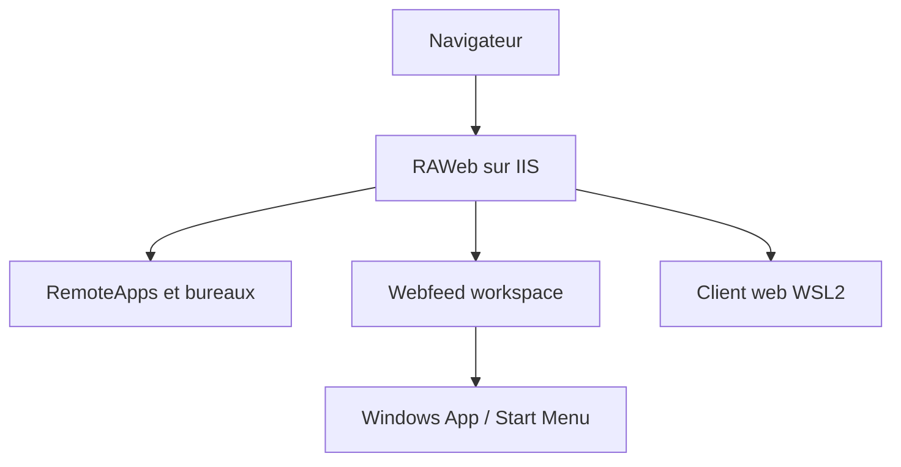

# kimmknight/raweb

> Interface web et fournisseur d'espace de travail pour des RemoteApps et bureaux Windows.

## Le problème
Les applications publiées par Remote Desktop Services n'ont pas de portail web moderne ni de flux pour les clients Windows App.

## Ce que ça fait vraiment
Liste, recherche et classe les RemoteApps et bureaux, permet de les ajouter ou modifier, télécharge des fichiers RDP ou les lance. Il expose un flux « webfeed » pour le menu Démarrer de Windows et les clients mobiles, avec un client web via WSL2. Fonctionne sous IIS.

## Comment c'est branché
Schéma simplifié d'après la fiche, sans diagramme fourni.

## Essayer
Installation par l'installateur de la dernière release ; accès par défaut sur https://127.0.0.1/RAWeb. Aucune commande dans le README.

## Coût et pièges
Gratuit. Réservé à Windows 10, 11 ou Server ; installe IIS si absent. Le client web exige WSL2.

## Ce que ce n'est pas
Pas un outil de bureau à distance multiplateforme : il publie des ressources Windows existantes.

## Alternatives
Aucune alternative nommée dans le README (RemoteApp Tool est cité en complément).

## Pour toi
À ignorer : administration de bureaux Windows distants, sans lien avec un métier data / IA / MLOps.

