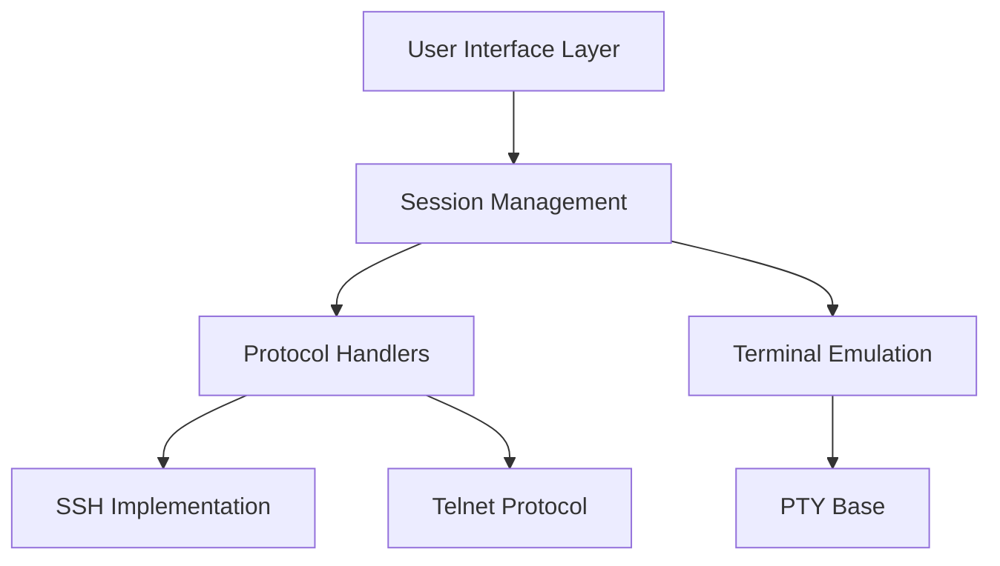

# kingToolbox/WindTerm

> Desktop SSH, Telnet, serial and SFTP client, for administrators and DevOps.

## The problem
PuTTY, xterm and classic terminals are slow on large volumes of output and poor at session management.

## What it actually does
Multi-protocol terminal (SSH v2, Telnet, raw TCP, serial, local shell) with built-in SFTP/SCP, tmux, ProxyJump, port forwarding, X11, SSH agent, ZModem. It adds a command palette, completion, tree-structured sessions, split views, themes and vim mode. Its benchmarks, dated 2020, claim much lower memory use than rxvt or xterm. "Partially" open source: part of the code remains closed.

## How it is wired

## Trying it
No command: download the Windows, macOS or Linux binary from the repository's Releases page.

## Cost and gotchas
Free. No license declared in the catalog and code published "partially": usage and redistribution rights are unclear. Last push in March 2025, more than 2,400 open issues.

## What it is not
Not fully open software, and not an automation tool (Ansible, etc.). The performance figures are over five years old.

## Alternatives
No alternative cited in the README (it compares with PuTTY, xterm, iTerm2, kitty, Alacritty, FileZilla, WinSCP).

## For you
Worth watching: handy for GPU servers over SSH, but the lack of a license and the slowed maintenance suggest keeping your current terminal.
