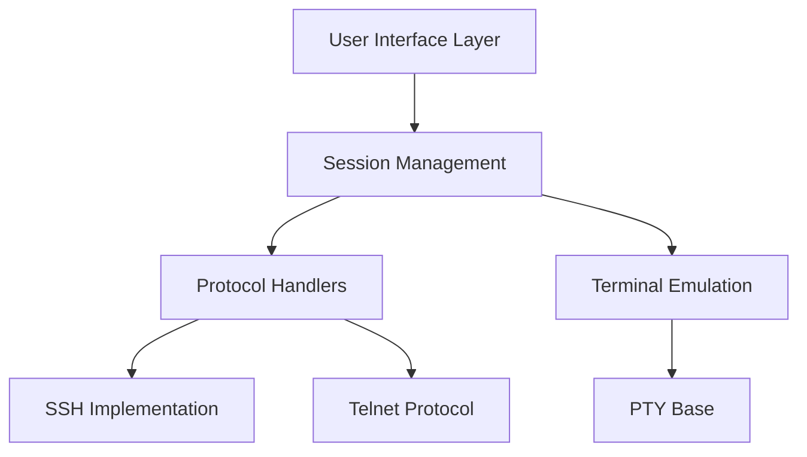

# kingToolbox/WindTerm

> Client SSH, Telnet, série et SFTP de bureau, pour administrateurs et DevOps.

## Le problème
PuTTY, xterm et les terminaux classiques sont lents sur de gros volumes de sortie et pauvres en gestion de sessions.

## Ce que ça fait vraiment
Terminal multi-protocole (SSH v2, Telnet, TCP brut, série, shell local) avec SFTP/SCP intégré, tmux, ProxyJump, redirections de ports, X11, agent SSH, ZModem. Il ajoute palette de commandes, complétion, sessions arborescentes, vues scindées, thèmes et mode vim. Ses benchmarks, datés de 2020, annoncent une mémoire bien plus faible que rxvt ou xterm. Open source « partiel » : une partie du code reste fermée.

## Comment c'est branché

## Essayer
Aucune commande : télécharger le binaire Windows, macOS ou Linux sur la page des Releases du dépôt.

## Coût et pièges
Gratuit. Aucune licence déclarée dans le catalogue et code publié « partiellement » : droits d'usage et de redistribution flous. Dernier push en mars 2025, plus de 2 400 issues ouvertes.

## Ce que ce n'est pas
Pas un logiciel entièrement ouvert, et pas un outil d'automatisation (Ansible, etc.). Les chiffres de performance ont plus de cinq ans.

## Alternatives
Aucune alternative citée dans le README (il compare à PuTTY, xterm, iTerm2, kitty, Alacritty, FileZilla, WinSCP).

## Pour toi
À surveiller : pratique pour des serveurs GPU en SSH, mais l'absence de licence et la maintenance ralentie incitent à garder ton terminal actuel.

