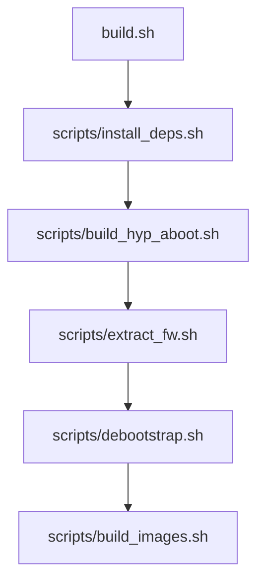

# kinsamanka/OpenStick-Builder

> Debian image builder for MSM8916-based 4G modem sticks, for tinkerers.

## The problem
Cheap 4G sticks run a frozen firmware; turning one into a mini Linux server requires building an image.

## What it actually does
`build.sh` chains dependency installation, hyp and lk2nd bootloaders, Qualcomm firmware extraction, a Debian rootfs via debootstrap, USB gadget tools, then image assembly, using the postmarketOS kernel. It can run through GitHub Actions. An EDL/fastboot flashing guide follows.

## How it is wired


## Trying it
```bash
git clone --recurse-submodules https://github.com/kinsamanka/OpenStick-Builder.git
cd OpenStick-Builder/
sudo ./build.sh
```

## Cost and gotchas
Free. Tested on Ubuntu 22.04, as root. Flashing can render the device unusable: backing up the original firmware is mandatory. Weak default credentials to change.

## What it is not
Not an intrusion tool: it reconfigures hardware you own. Not a data tool.

## Alternatives
No alternative named in the README (an alpine branch exists for an Alpine image).

## For you
Ignore: hardware tinkering unrelated to your data / AI work.
