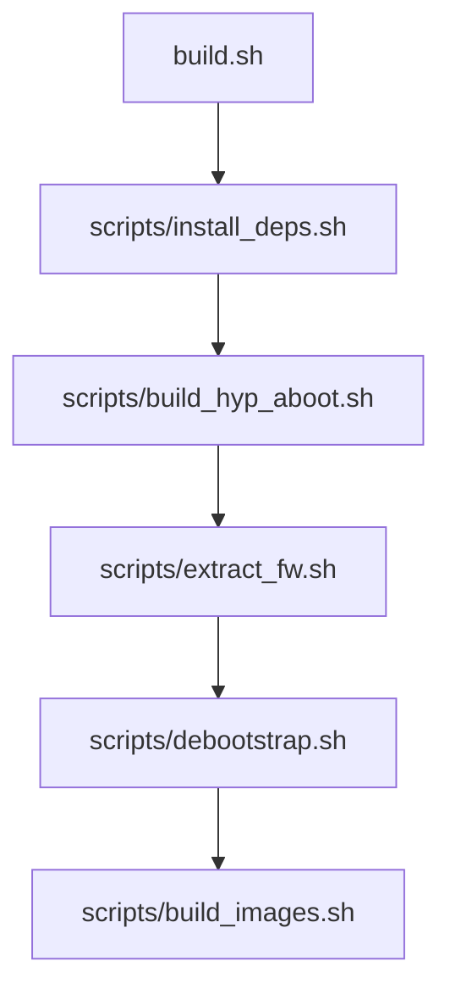

# kinsamanka/OpenStick-Builder

> Constructeur d'images Debian pour clés modem 4G à base de MSM8916, pour bricoleurs.

## Le problème
Les clés 4G bon marché tournent sur un firmware figé ; en faire un mini-serveur Linux demande de construire une image.

## Ce que ça fait vraiment
`build.sh` enchaîne installation des dépendances, bootloaders hyp et lk2nd, extraction du firmware Qualcomm, rootfs Debian via debootstrap, outils gadget USB puis assemblage des images, utilisant le noyau postmarketOS. Peut tourner via GitHub Actions. Un guide de flashage EDL/fastboot suit.

## Comment c'est branché


## Essayer
```bash
git clone --recurse-submodules https://github.com/kinsamanka/OpenStick-Builder.git
cd OpenStick-Builder/
sudo ./build.sh
```

## Coût et pièges
Gratuit. Testé sur Ubuntu 22.04, en root. Le flashage peut rendre l'appareil inutilisable : sauvegarde du firmware d'origine obligatoire. Identifiants par défaut faibles à changer.

## Ce que ce n'est pas
Pas un outil d'intrusion : il reconfigure du matériel qu'on possède. Pas un outil data.

## Alternatives
Aucune alternative nommée dans le README (une branche alpine existe pour une image Alpine).

## Pour toi
Ignorer : bricolage matériel sans lien avec ton métier data / IA.

