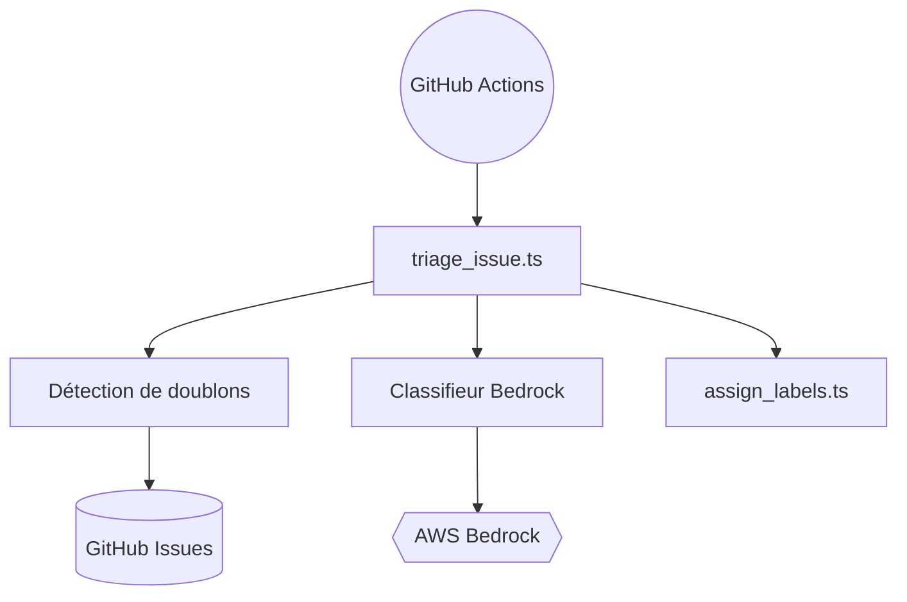

# kirodotdev/Kiro

> Public issue tracker for Kiro, AWS's agentic development platform, for its users.

## The problem
Kiro users need a place to report bugs and suggest ideas. The product's code is not public.

## What it actually does
The repository does not contain the product: it is the issue tracker. It ships automation scripts: duplicate detection by similarity, classification through Bedrock, label assignment, acknowledgement, spam removal, closing of duplicates and stale issues.

## How it is wired

## Trying it
The README documents no command: it points to the IDE download, the CLI setup and the product documentation.

## Cost and gotchas
The product requires an account and a subscription (pricing page). Cloud sessions are in preview. The repository's automation assumes access to AWS Bedrock.

## What it is not
It is not Kiro's code, nor an installable tool. No license is declared.

## Alternatives
No alternative named in the README.

## For you
Ignore this repository: it only contains issue tracking. The Bedrock-based triage can inspire an issue-sorting workflow, but no more than that.
