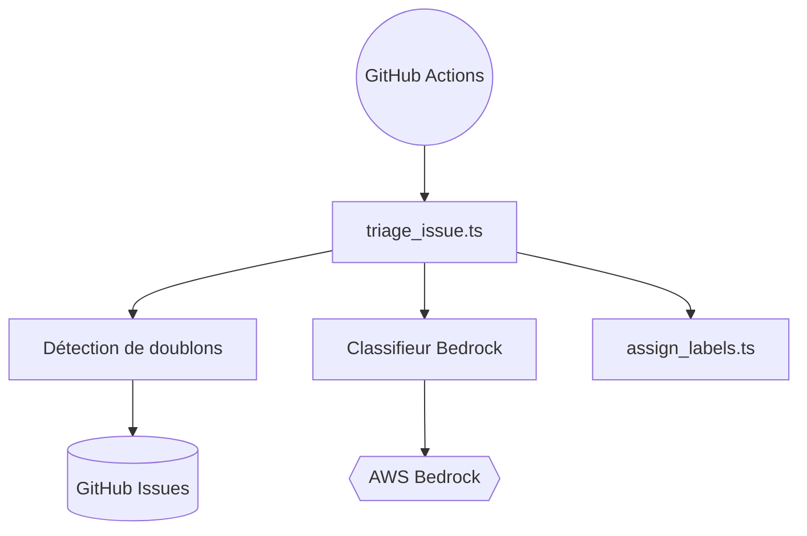

# kirodotdev/Kiro

> Suivi public des tickets de Kiro, la plateforme de développement agentique d'AWS, pour ses utilisateurs.

## Le problème
Les utilisateurs de Kiro ont besoin d'un endroit pour signaler des bogues et proposer des idées. Le code du produit n'est pas public.

## Ce que ça fait vraiment
Le dépôt ne contient pas le produit : c'est le tracker de tickets. Il embarque des scripts d'automatisation : détection de doublons par similarité, classification par Bedrock, pose d'étiquettes, accusé de réception, suppression de spam, fermeture des doublons et des tickets périmés.

## Comment c'est branché

## Essayer
Le README ne documente aucune commande : il renvoie vers le téléchargement de l'IDE, la configuration de la CLI et la documentation du produit.

## Coût et pièges
Le produit demande un compte et un abonnement (page tarifs). Les sessions cloud sont en préversion. L'automatisation du dépôt suppose un accès AWS Bedrock.

## Ce que ce n'est pas
Ce n'est pas le code de Kiro, ni un outil installable. Aucune licence n'est déclarée.

## Alternatives
Aucune alternative nommée dans le README.

## Pour toi
Ignorer ce dépôt : il ne contient que du suivi de tickets. Le triage par Bedrock peut inspirer un workflow de tri d'issues, mais pas plus.

