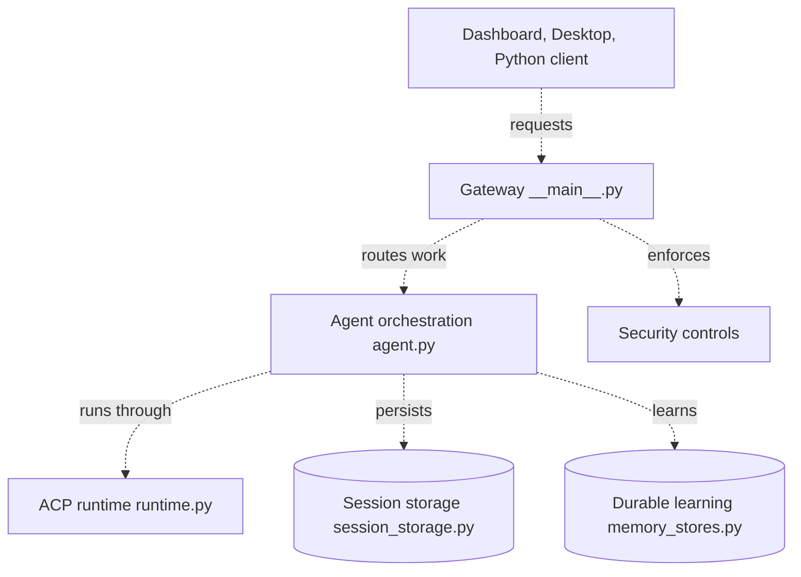

# kirodotdev/KiroCrew

> Persistent agent workspace, local or remote, that keeps sessions, memory and tasks between conversations.

## The problem
Agent sessions end when the chat is closed: no more context, no tracking of long or recurring tasks.

## What it actually does
- A Gateway keeps sessions, memory, schedules and approvals, and drives the agent through an ACP backend (`kiro-cli` by default).
- Long tasks with checkpoints, scheduled jobs, parallel sub-agents, MCP, skills and hooks.
- Lessons drawn from corrections, skills synthesized from repeated patterns.
- Access through a desktop app, web dashboard, CLI, Slack and Discord.

## How it is wired


## Trying it
```bash
curl -fsSL https://download.crew.kiro.dev/cli.sh | sh
kirocrew setup
kirocrew doctor
kirocrew gateway
```

## Cost and gotchas
The default agent requires `kiro-cli`, installed and signed in separately (Kiro account). The model cost is not detailed in the README. Anonymous daily telemetry is enabled by default, and can be disabled. 3,050 open issues.

## What it is not
Not a model nor an independent autonomous agent: it orchestrates an external harness. The diagram's links are mostly documented, not all inspected in the code.

## Alternatives
The README names no alternative.

## For you
Worth watching: an approach to agent persistence, memory and scheduling worth studying, but tied to the Kiro ecosystem and still young with an issue backlog.
