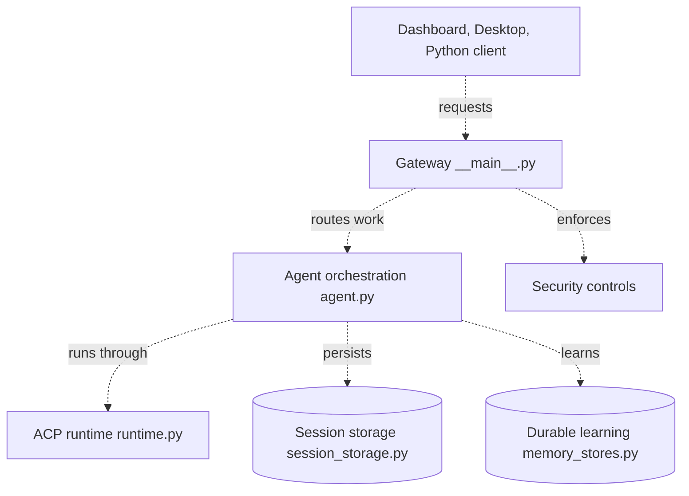

# kirodotdev/KiroCrew

> Espace de travail d'agents persistant, local ou distant, qui garde sessions, mémoire et tâches entre les conversations.

## Le problème
Les sessions d'agents s'arrêtent à la fermeture du chat : plus de contexte, plus de suivi des tâches longues ou récurrentes.

## Ce que ça fait vraiment
- Un Gateway garde sessions, mémoire, planifications et approbations, et pilote l'agent via un backend ACP (`kiro-cli` par défaut).
- Tâches longues avec points de reprise, jobs planifiés, sous-agents parallèles, MCP, skills et hooks.
- Leçons tirées des corrections, skills synthétisés depuis les motifs répétés.
- Accès par appli desktop, tableau de bord web, CLI, Slack et Discord.

## Comment c'est branché


## Essayer
```bash
curl -fsSL https://download.crew.kiro.dev/cli.sh | sh
kirocrew setup
kirocrew doctor
kirocrew gateway
```

## Coût et pièges
L'agent par défaut exige `kiro-cli`, installé et connecté séparément (compte Kiro). Le coût du modèle n'est pas détaillé dans le README. Télémétrie quotidienne anonyme activée par défaut, désactivable. 3 050 issues ouvertes.

## Ce que ce n'est pas
Pas un modèle ni un agent autonome indépendant : il orchestre un harnais externe. Les liens du diagramme sont surtout documentés, pas tous inspectés dans le code.

## Alternatives
Le README ne nomme aucune alternative.

## Pour toi
À surveiller : approche persistance, mémoire et planification d'agents à étudier, mais liée à l'écosystème Kiro et encore jeune avec un arriéré d'issues.

