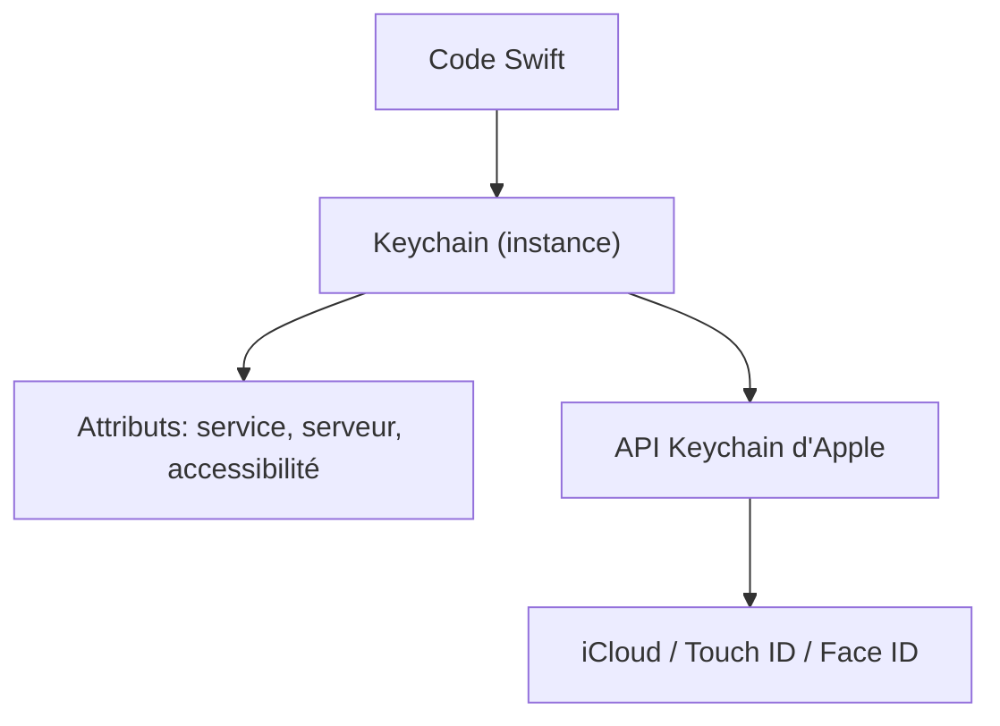

# kishikawakatsumi/KeychainAccess

> Simple Swift wrapper around the Apple Keychain, for iOS and macOS developers.

## The problem
Apple's Keychain API is verbose and unpleasant to use in Swift.

## What it actually does
The library reads, writes and deletes passwords or data in the Keychain using subscript or method syntax. It handles access groups, accessibility, iCloud synchronization, Touch ID / Face ID and shared web credentials.

## How it is wired
Simplified diagram based on the sheet, no diagram provided.


## Trying it
```bash
pod 'KeychainAccess'          # dans le Podfile (CocoaPods)
github "kishikawakatsumi/KeychainAccess"   # dans le Cartfile (Carthage)
swift build                    # avec Swift Package Manager
```

## Cost and gotchas
Free. The README requires adding a Keychain.entitlements file in case of error -34018. Operations protected by biometrics must run off the main thread.

## What it is not
It is not a cross-platform secrets manager: it only works on Apple platforms. Last push in May 2024.

## Alternatives
No alternative named in the README.

## For you
Ignore: this is Apple app development, outside a data/AI/MLOps profile, and the repo has not moved since May 2024.
