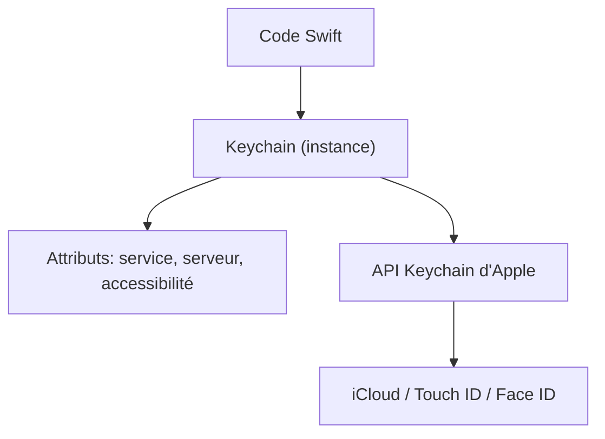

# kishikawakatsumi/KeychainAccess

> Enveloppe Swift simple autour du Trousseau Apple, pour développeurs iOS et macOS.

## Le problème
L'API Keychain d'Apple est verbeuse et peu agréable à utiliser en Swift.

## Ce que ça fait vraiment
La bibliothèque lit, écrit et supprime des mots de passe ou données dans le Trousseau avec une écriture par indices ou par méthodes. Elle gère les groupes d'accès, l'accessibilité, la synchronisation iCloud, Touch ID / Face ID et les identifiants web partagés.

## Comment c'est branché
Schéma simplifié d'après la fiche, sans diagramme fourni.


## Essayer
```bash
pod 'KeychainAccess'          # dans le Podfile (CocoaPods)
github "kishikawakatsumi/KeychainAccess"   # dans le Cartfile (Carthage)
swift build                    # avec Swift Package Manager
```

## Coût et pièges
Gratuit. Le README exige d'ajouter un fichier Keychain.entitlements en cas d'erreur -34018. Les opérations protégées par biométrie doivent tourner hors du thread principal.

## Ce que ce n'est pas
Ce n'est pas un gestionnaire de secrets multiplateforme : il ne fonctionne que sur les plateformes Apple. Dernier push en mai 2024.

## Alternatives
Aucune alternative nommée dans le README.

## Pour toi
À ignorer : c'est du développement d'applications Apple, hors d'un profil data/IA/MLOps, et le dépôt n'a plus bougé depuis mai 2024.

