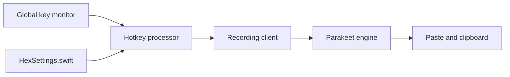

# kitlangton/Hex

> Former macOS voice dictation app: kept as an archive, replaced by a Rust version elsewhere.

## The problem
Dictate text into any application without going through a cloud service.

## What it actually does
A global shortcut: hold the key, speak, release, and the transcription is pasted into the active application. Double-tap to lock recording. Local transcription via Parakeet TDT v3 (FluidAudio) and WhisperKit, Apple Silicon only. History, word remapping and model downloads included. The repository keeps only the Swift version; the author rewrote Hex in Rust (anomalyco/hex).

## How it is wired


## Trying it
```bash
brew install --cask kitlangton-hex
```

## Cost and gotchas
Free. Microphone and accessibility permissions must be granted. Apple Silicon required.

## What it is not
Not the current version: the README points to the new Rust repository. Not available outside macOS.

## Alternatives
anomalyco/hex (Rust rewrite, cited in the README).

## For you
Ignore: the active version is elsewhere and this repository now only preserves the Swift history.
