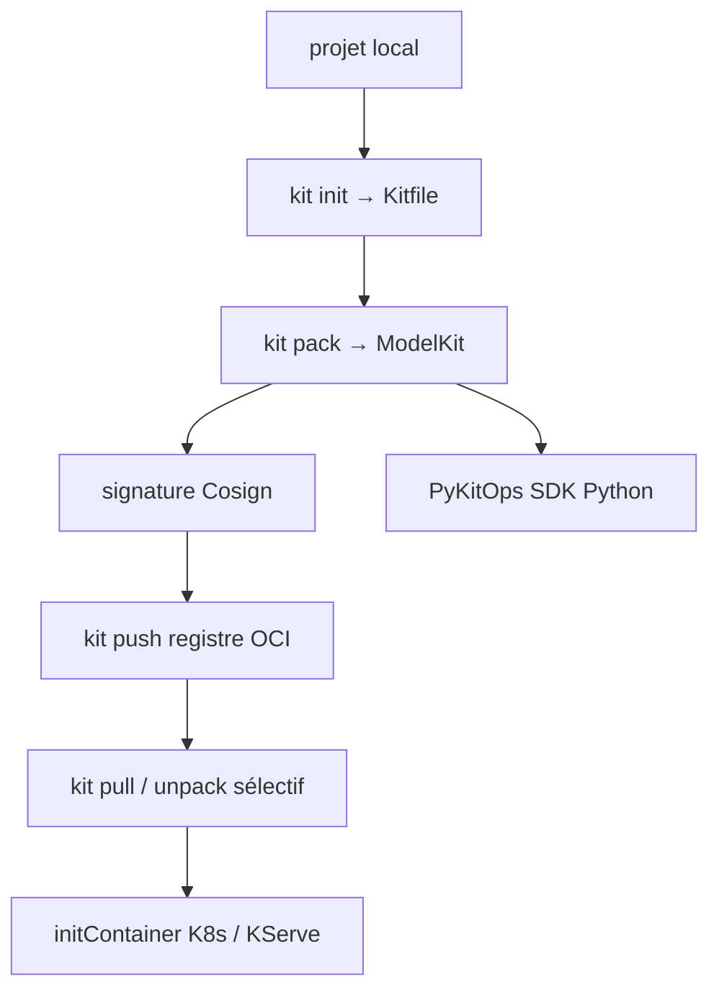

# kitops-ml/kitops

> Packages models, datasets, code and configuration into versioned, signable OCI artifacts.

## The problem
A model's weights, its data, its prompts and its configuration live in different places and drift out of sync.
Nothing guarantees, at deployment time, that the whole matches the validated version.

## What it actually does
Wraps the project into a **ModelKit**: an immutable, layered package stored in an existing container registry.
Each component is hashed with SHA-256, the artifact can be signed with Cosign (key or keyless OIDC), and a tampered package is rejected on pull.
Unpacking is selective: you can pull only the model, or only the dataset.
The `Kitfile` describes where each artifact lives and is generated with `kit init`; the CNCF ModelPack format is handled transparently by the same commands.

## How it is wired


## Trying it
```bash
kit init .
kit pack
kit push
kit inspect
kit diff
```

## Cost and gotchas
No service to pay for: storage reuses the container registry already in place.
Jozu Hub, mentioned in the README, is a separate product with centralized administration and five-layer scanning — it is not needed to use KitOps.

## What it is not
Not a registry: KitOps produces and reads artifacts, storage remains the organization's own.
Not an experiment-tracking tool: the MLflow integration is for packaging a run, not replacing it.
The properties advertised for the EU AI Act or ISO 42001 are integrity and traceability building blocks, not delivered compliance.

## Alternatives
- ModelPack: the neutral CNCF specification, which KitOps implements rather than competes with.

## For you
It is the missing link between a validated model and a traceable deployment — test it on a real model before making it a team rule.
