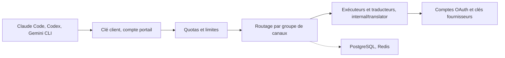

# kittors/CliRelay

> Self-hosted gateway that puts AI subscriptions and API keys behind a single entry point, with a multi-tenant panel.

## The problem
A team using Claude Code, Codex or Gemini CLI juggles several accounts, with no view of consumption and no failover when a quota runs out.

## What it actually does
Clients speak the OpenAI, Anthropic or Gemini protocol; CliRelay authenticates by key, applies quotas and limits, picks a healthy account, translates the protocol and logs every request. A web panel manages accounts, pricing, roles, tenants and an audit log. PostgreSQL stores state, Redis the caches.

## How it is wired


## Trying it
```bash
git clone https://github.com/kittors/CliRelay.git
cd CliRelay
docker compose up -d
export ANTHROPIC_BASE_URL=http://localhost:8317
export ANTHROPIC_AUTH_TOKEN=sk-your-client-key
claude
```

## Cost and gotchas
The upstream subscriptions and keys remain at your expense. The README mentions importing cookies or session tokens from subscription accounts: check this against the providers' terms of use.

## What it is not
Not a model provider: it redistributes accounts that you own. A heavily extended fork of CLIProxyAPI, named as such by the README.

## Alternatives
CLIProxyAPI, of which it is an extended fork.

## For you
Worth watching: handy for measuring and capping a team's LLM usage, but building on consumer subscriptions carries a compliance risk.
