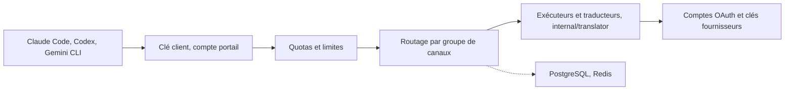

# kittors/CliRelay

> Passerelle auto-hébergée qui place abonnements IA et clés d'API derrière un point d'entrée unique, avec panneau multi-tenant.

## Le problème
Une équipe qui utilise Claude Code, Codex ou Gemini CLI jongle avec plusieurs comptes, sans vue sur la consommation ni basculement quand un quota est épuisé.

## Ce que ça fait vraiment
Les clients parlent au protocole OpenAI, Anthropic ou Gemini ; CliRelay authentifie par clé, applique quotas et limites, choisit un compte sain, traduit le protocole et enregistre chaque requête. Un panneau web gère comptes, tarifs, rôles, tenants et journal d'audit. PostgreSQL stocke l'état, Redis les caches.

## Comment c'est branché


## Essayer
```bash
git clone https://github.com/kittors/CliRelay.git
cd CliRelay
docker compose up -d
export ANTHROPIC_BASE_URL=http://localhost:8317
export ANTHROPIC_AUTH_TOKEN=sk-your-client-key
claude
```

## Coût et pièges
Les abonnements et clés amont restent à ta charge. Le README mentionne l'import de cookies ou jetons de session de comptes d'abonnement : à vérifier au regard des conditions d'usage des fournisseurs.

## Ce que ce n'est pas
Pas un fournisseur de modèles : il redistribue des comptes que tu possèdes. Fork très étendu de CLIProxyAPI, nommé comme tel par le README.

## Alternatives
CLIProxyAPI, dont il est un fork étendu.

## Pour toi
À surveiller : pratique pour mesurer et plafonner l'usage LLM d'une équipe, mais le montage sur des abonnements grand public pose un risque de conformité.

