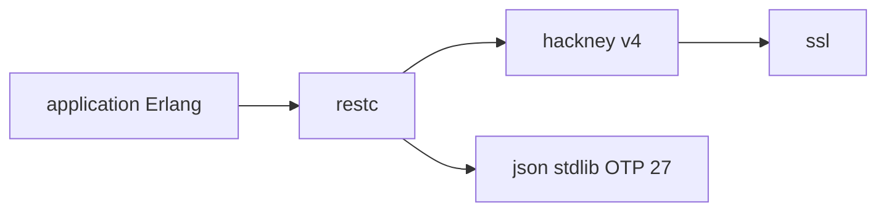

# kivra/restclient

> Erlang library for consuming REST services with JSON, XML and percent encoding.

## The problem
Calling REST APIs from Erlang requires manually encoding and decoding JSON, XML and URLs.

## What it actually does
Provides restc:request to call a URL and decode the response (JSON via the stdlib json module, OTP 27 or later), plus functions for building URLs and query parameters. Uses hackney v4, compatible with v1 usage.

## How it is wired


## Trying it
```bash
# rebar.config
{deps, [{restc, {git, "https://github.com/kivra/restclient.git", {tag, "0.12.0"}}}]}.
```
```erlang
application:ensure_all_started(restc).
restc:request(get, "https://api.github.com").
```

## Cost and gotchas
Free. Requires OTP 27 or later. The hex.pm versions are no longer maintained: depend on a git tag.

## What it is not
Not a Python client nor a specific API SDK: a generic HTTP/REST client for Erlang. The prerequisites ticked above are an approximation.

## Alternatives
- hackney: the HTTP library it is built on.

## For you
Ignore: Erlang library, outside your Python/AI stack.
