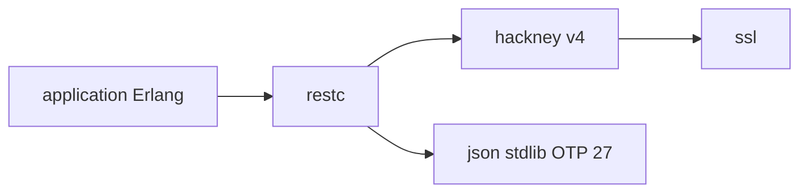

# kivra/restclient

> Bibliothèque Erlang pour consommer des services REST avec JSON, XML et encodage pourcentage.

## Le problème
Appeler des API REST depuis Erlang demande d'encoder et décoder à la main JSON, XML et URLs.

## Ce que ça fait vraiment
Offre restc:request pour appeler une URL et décoder la réponse (JSON via le module json de la stdlib, OTP 27 ou plus), plus des fonctions de construction d'URL et de paramètres de requête. Utilise hackney v4, compatible avec l'usage v1.

## Comment c'est branché


## Essayer
```bash
# rebar.config
{deps, [{restc, {git, "https://github.com/kivra/restclient.git", {tag, "0.12.0"}}}]}.
```
```erlang
application:ensure_all_started(restc).
restc:request(get, "https://api.github.com").
```

## Coût et pièges
Gratuit. Requiert OTP 27 ou plus. Les versions hex.pm ne sont plus maintenues : dépendre d'un tag git.

## Ce que ce n'est pas
Pas un client Python ni un SDK d'API précis : un client HTTP/REST générique pour Erlang. Les prérequis cochés plus haut sont une approximation.

## Alternatives
- hackney : la bibliothèque HTTP sur laquelle il repose.

## Pour toi
Ignorer : bibliothèque Erlang, hors de ta pile Python/IA.

