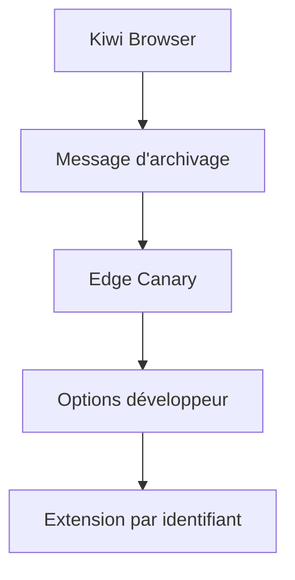

# kiwibrowser/src.next

> The Kiwi Android browser, whose README announces the end of maintenance.

## The problem
Android did not offer desktop extensions in a mobile browser; Kiwi made it possible.

## What it actually does
The README no longer describes the browser: it announces that it is archived and will no longer be maintained after January 2025. It suggests migrating to Microsoft Edge Canary, where Kiwi's extension code was integrated, and gives the procedure to install an extension by identifier. It cites Vivaldi and Firefox as other options. The catalog, however, says not archived, but the last push dates from June 2025.

## How it is wired
Simplified diagram based on the sheet, no diagram provided.


## Trying it
```bash
# Aucune commande : la procédure se fait dans les réglages d'Edge Canary (touche 5 fois sur le numéro de build).
```

## Cost and gotchas
Free. Download Kiwi only from the link in the README. An existing installation may keep working for a while but no longer receives security fixes.

## What it is not
No longer a living project. This repo is an end-of-maintenance notice, not a browser to adopt.

## Alternatives
Microsoft Edge Canary, Vivaldi Browser and Mozilla Firefox: the three cited by the README, all maintained.

## For you
Ignore: an end-of-life browser, unrelated to your work; migrate to one of the cited alternatives.
