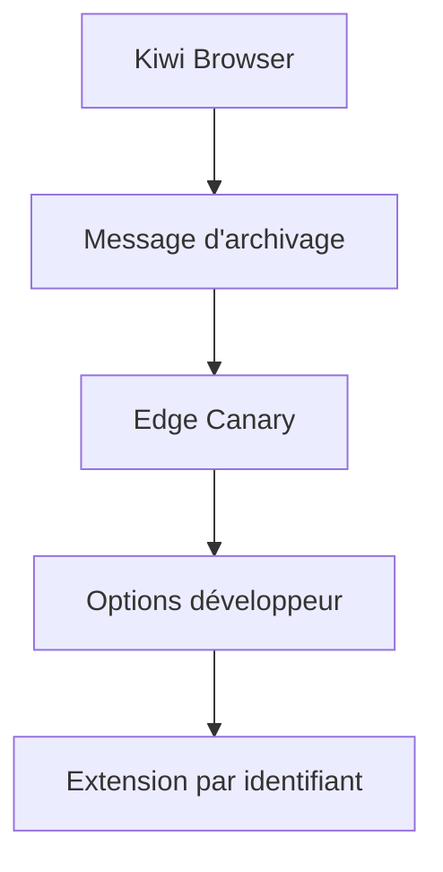

# kiwibrowser/src.next

> Navigateur Android Kiwi, dont le README annonce l'arrêt de la maintenance.

## Le problème
Android n'offrait pas d'extensions de bureau dans un navigateur mobile ; Kiwi le permettait.

## Ce que ça fait vraiment
Le README ne décrit plus le navigateur : il annonce qu'il est archivé et ne sera plus maintenu après janvier 2025. Il propose une migration vers Microsoft Edge Canary, où le code des extensions de Kiwi a été intégré, et la procédure pour installer une extension par identifiant. Il cite Vivaldi et Firefox comme autres options. Le catalogue, lui, indique non archivé, mais le dernier push date de juin 2025.

## Comment c'est branché
Schéma simplifié d'après la fiche, sans diagramme fourni.


## Essayer
```bash
# Aucune commande : la procédure se fait dans les réglages d'Edge Canary (touche 5 fois sur le numéro de build).
```

## Coût et pièges
Gratuit. Ne télécharger Kiwi que depuis le lien du README. L'installation existante peut fonctionner un temps mais ne reçoit plus de correctifs de sécurité.

## Ce que ce n'est pas
Ce n'est plus un projet vivant. Ce dépôt est un avis de fin de maintenance, pas un navigateur à adopter.

## Alternatives
Microsoft Edge Canary, Vivaldi Browser et Mozilla Firefox : les trois cités par le README, maintenus.

## Pour toi
À ignorer : navigateur en fin de vie, sans rapport avec ton métier ; migre vers l'une des alternatives citées.

