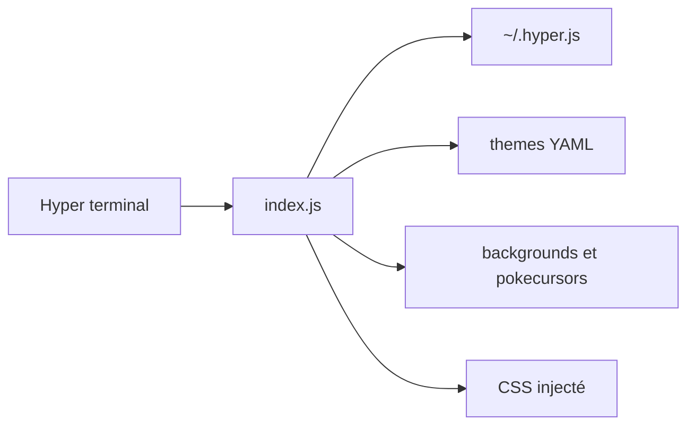

# klaudiosinani/hyper-pokemon

> Pokémon themes for the Hyper terminal: background, syntax colors and animated tab.

## The problem
Customizing a Hyper terminal with a theme featuring your favorite Pokémon.

## What it actually does
A plugin that reads `~/.hyper.js` (options `pokemon`, `unibody`, `poketab`) and injects the theme's background and colors, chosen by name, type, trainer, at random or from a list. Themes come from YAML files and images in the repository.

## How it is wired


## Trying it
```bash
hyper i hyper-pokemon
```
Then add `pokemon: 'gengar'` in the `config` section of `~/.hyper.js`.

## Cost and gotchas
Free. The backgrounds were created by third-party artists (Teej/TopHat, MapleRose, Ferretdayo): their rights are not detailed. The `poketab` option is disabled by default.

## What it is not
It is not a terminal nor a productivity tool; the themes add nothing functional.

## Alternatives
- Hyperocean: ocean-blue theme for Hyper.
- Hyper Star Wars: Star Wars themes for Hyper.

## For you
Ignore: a mere terminal skin, with no effect on data or AI work.
