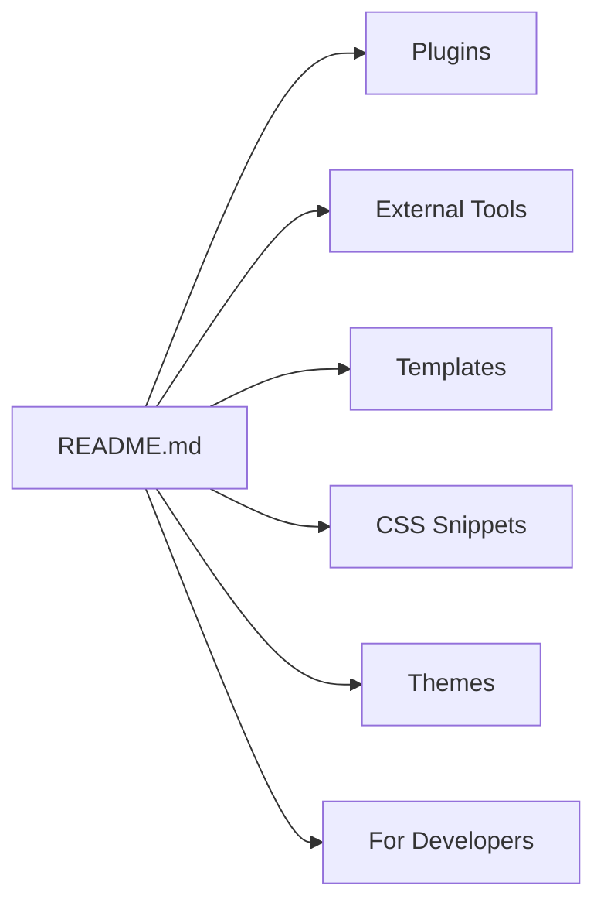

# kmaasrud/awesome-obsidian

> List of themes, plugins, CSS snippets, templates and external tools for Obsidian note-taking.

## The problem
The Obsidian ecosystem is sprawling and scattered: themes, converters, web publishing, vault templates. Finding them takes time.

## What it actually does
A README made of tables: resources and videos, plugins, external tools (Notion/Evernote converters, browser extensions, publishing such as quartz), vault templates, about twenty CSS snippets, a long list of themes and links for developing themes and plugins.

## How it is wired


## Trying it
```bash
# Aucune commande documentée.
# Les snippets .css se copient dans vault/.obsidian/snippets
```

## Cost and gotchas
Free. Last push in April 2024: links and plugins to be verified. Many themes are also available via Settings > Appearance > Community themes.

## What it is not
Not a plugin or an application: an index. No compatibility testing with recent versions of Obsidian.

## Alternatives
- Obsidian Help and the community directory built into the application, cited in the README.

## For you
Keep an eye on it: only if Obsidian is your note-taking tool; the converters and vault templates mainly help you get started.
