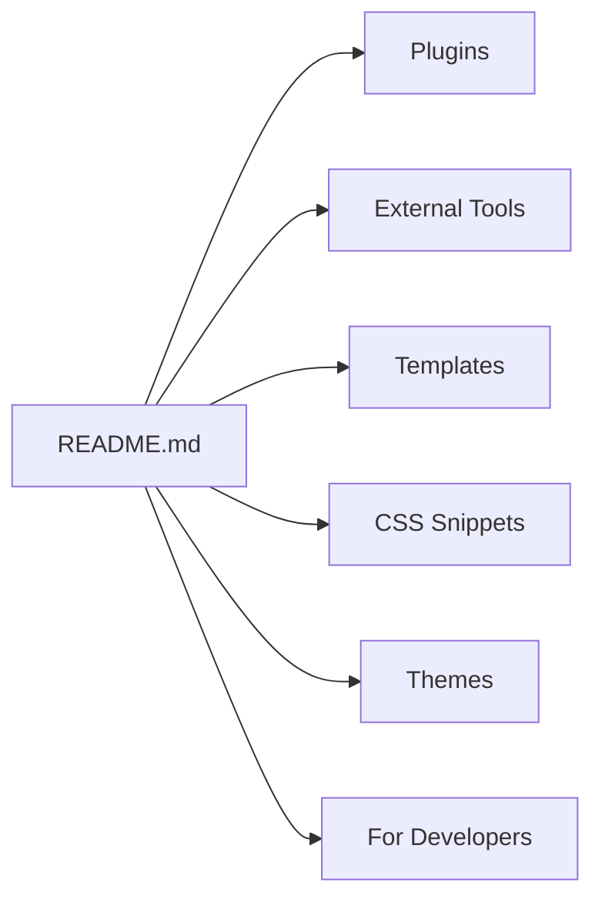

# kmaasrud/awesome-obsidian

> Liste de thèmes, plugins, snippets CSS, modèles et outils externes pour la prise de notes Obsidian.

## Le problème
L'écosystème Obsidian est foisonnant et éparpillé : thèmes, convertisseurs, publication web, modèles de coffres. Les repérer demande du temps.

## Ce que ça fait vraiment
Un README en tableaux : ressources et vidéos, plugins, outils externes (convertisseurs Notion/Evernote, extensions de navigateur, publication comme quartz), modèles de coffres, une vingtaine de snippets CSS, une longue liste de thèmes et des liens pour développer thèmes et plugins.

## Comment c'est branché


## Essayer
```bash
# Aucune commande documentée.
# Les snippets .css se copient dans vault/.obsidian/snippets
```

## Coût et pièges
Gratuit. Dernier push en avril 2024 : liens et plugins à vérifier. Beaucoup de thèmes sont aussi accessibles via Réglages > Apparence > Thèmes de la communauté.

## Ce que ce n'est pas
Pas un plugin ni une application : un index. Pas de test de compatibilité avec les versions récentes d'Obsidian.

## Alternatives
- Obsidian Help et l'annuaire communautaire intégré à l'application, cités dans le README.

## Pour toi
Surveiller : seulement si Obsidian est ton outil de notes, les convertisseurs et modèles de coffre servent surtout à démarrer.

