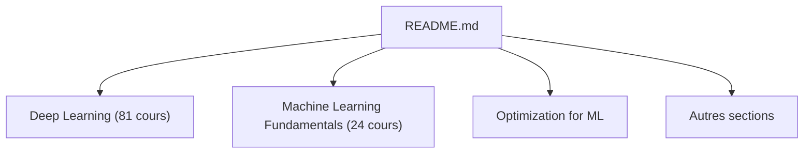

# kmario23/deep-learning-drizzle

> List of university video courses on deep learning, machine learning and neighboring fields.

## The problem
The best online courses are scattered and hard to find by topic and year.

## What it actually does
An index of tables: each row gives the course, the teacher or university, the course page, the videos and the year. The table of contents covers deep learning, ML fundamentals, optimization, reinforcement learning, deep Bayesian learning, graphs, probabilistic graphical models, NLP, speech recognition, vision and medical imaging. The sections read count 81 deep learning courses and 24 ML fundamentals courses.

## How it is wired

Diagram inferred from the README; the README is truncated after the optimization section.

## Trying it
No command: open the README and follow the links.

## Cost and gotchas
Free. Links are external (YouTube, university pages) and can die. The provided README is truncated: the sections after "Optimization for Machine Learning" were not read.

## What it is not
Not a course: a list of links, with no quality assessment. No license declared. The most recent courses listed date from 2022.

## Alternatives
No alternative named in the README.

## For you
Worth watching as a training bookmark: useful for choosing a course, but dated content that does not replace recent sources.
