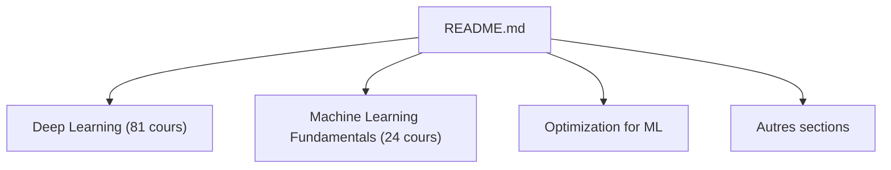

# kmario23/deep-learning-drizzle

> Liste de cours universitaires en vidéo sur le deep learning, le machine learning et domaines voisins.

## Le problème
Les meilleurs cours en ligne sont dispersés et difficiles à retrouver par thème et par année.

## Ce que ça fait vraiment
Un index de tableaux : chaque ligne donne le cours, l'enseignant ou l'université, la page du cours, les vidéos et l'année. La table des matières couvre apprentissage profond, bases du ML, optimisation, apprentissage par renforcement, bayésien profond, graphes, modèles graphiques probabilistes, NLP, reconnaissance vocale, vision et imagerie médicale. Les sections lues comptent 81 cours de deep learning et 24 de bases du ML.

## Comment c'est branché

Diagramme déduit du README ; le README est tronqué après la section optimisation.

## Essayer
Aucune commande : ouvrir le README et suivre les liens.

## Coût et pièges
Gratuit. Les liens sont externes (YouTube, pages d'universités) et peuvent mourir. Le README fourni est tronqué : les sections après « Optimization for Machine Learning » n'ont pas été lues.

## Ce que ce n'est pas
Pas un cours : une liste de liens, sans évaluation de qualité. Aucune licence déclarée. Les cours les plus récents listés datent de 2022.

## Alternatives
Aucune alternative nommée dans le README.

## Pour toi
À surveiller comme signet de formation : utile pour choisir un cours, mais un contenu daté qui ne remplace pas des sources récentes.

