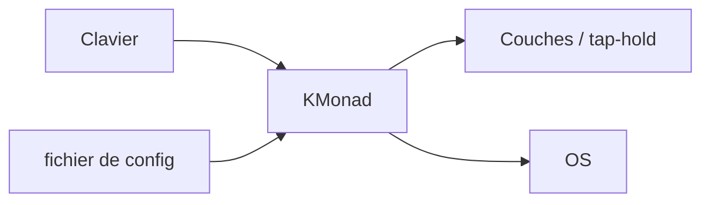

# kmonad/kmonad

> Keyboard remapping tool with layers and multi-use keys, on Linux, Windows and macOS.

## The problem
Keyboards without QMK firmware have neither layers nor tap-hold. Remapping Caps Lock or putting modifiers on the home row is not possible natively.

## What it actually does
Low-level key manipulation: unlimited layers, multi-tap, tap-hold (Caps Lock = Escape on tap, Ctrl when held), combined modifiers, and command buttons that run shell commands. Configured via a file; the details are deferred to the documentation.

## How it is wired


## Trying it
```bash
# Aucune commande dans le README : voir les pages installation et
# configuration tutorial. Scripts de démarrage dans startup/.
```

## Cost and gotchas
Free. The README tells you to take master for the stable binary and develop to build. The main maintainer, who is ill, may be absent for weeks.

## What it is not
Not keyboard firmware: it acts at the operating system level. The shell commands of the buttons run with its privileges.

## Alternatives
No alternative named in the README, apart from the QMK firmware cited as a feature reference.

## For you
Watch: real typing comfort if you code a lot, but unrelated to data or AI and with a single maintainer.
