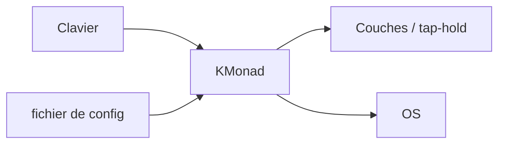

# kmonad/kmonad

> Outil de remappage de clavier avec couches et touches multi-usage, sous Linux, Windows et macOS.

## Le problème
Les claviers sans firmware QMK n'ont ni couches ni tap-hold. Remapper Caps Lock ou mettre les modificateurs sur la rangée de repos est impossible nativement.

## Ce que ce n'est pas
voir plus bas

## Ce que ça fait vraiment
Manipulation bas niveau des touches : couches illimitées, multi-tap, tap-hold (Caps Lock = Échap au tap, Ctrl maintenu), modificateurs combinés, et boutons de commande qui lancent des commandes shell. Se configure via un fichier ; le détail est renvoyé vers la documentation.

## Comment c'est branché


## Essayer
```bash
# Aucune commande dans le README : voir les pages installation et
# configuration tutorial. Scripts de démarrage dans startup/.
```

## Coût et pièges
Gratuit. Le README invite à prendre master pour le binaire stable et develop pour compiler. Le mainteneur principal, malade, peut être absent des semaines.

## Ce que ce n'est pas
Pas un firmware de clavier : il agit au niveau du système d'exploitation. Les commandes shell des boutons s'exécutent avec ses droits.

## Alternatives
Aucune alternative nommée dans le README, hormis le firmware QMK cité comme référence de fonctionnalités.

## Pour toi
Surveiller : confort de frappe réel si tu codes beaucoup, mais sans rapport avec la data ou l'IA et à mainteneur unique.

