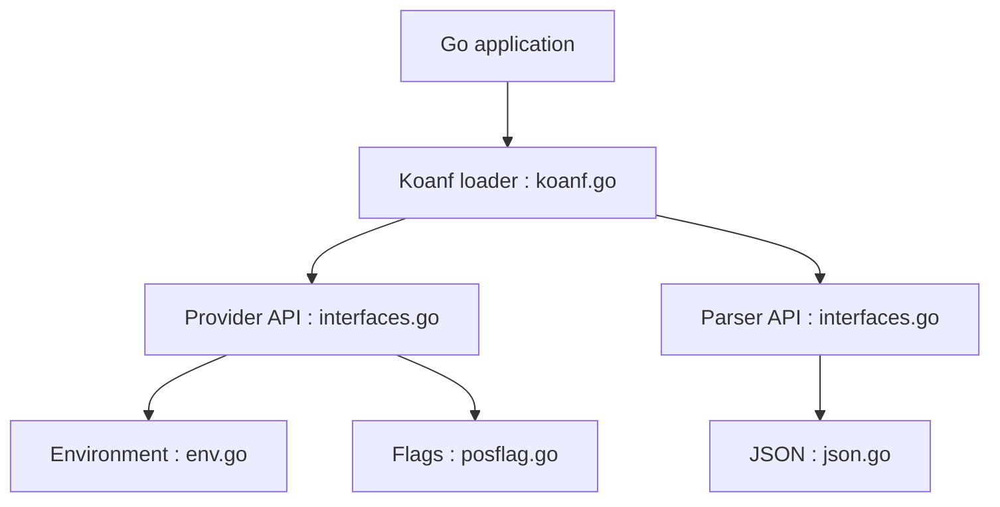

# knadh/koanf

> Go library for reading configuration from multiple sources and formats, a lighter alternative to viper.

## The problem
Viper forces lowercase keys, couples parsing to file extensions and pulls in many dependencies.

## What it actually does
Two interfaces: Provider (file, environment variables, flags, S3, Vault, Consul, etcd, maps, structs…) and Parser (JSON, YAML, TOML, HCL, dotenv…). You load and merge in the order you want, then read by key path (`app.server.port`), unmarshal into structs or marshal back. Dependencies are installed separately from the core.

## How it is wired


## Trying it
```bash
go get -u github.com/knadh/koanf/v2
go get -u github.com/knadh/koanf/providers/file
go get -u github.com/knadh/koanf/parsers/toml
```

## Cost and gotchas
Free. File watching is not concurrency-safe without a lock. Keys are case-sensitive. Strict merging can fail between JSON and YAML (integers/floats).

## What it is not
Not an application framework nor a secrets manager: it reads and merges configuration.

## Alternatives
- spf13/viper: more widespread, but criticized by the README for key casing, dependencies and coupling.

## For you
Worth watching: a good choice if you write configurable Go services; irrelevant for Python.
