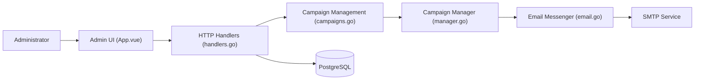

# knadh/listmonk

> Self-hosted newsletter and mailing list manager, a single binary on PostgreSQL.

## The problem
Hosted emailing services charge per contact and keep your lists. Doing without them means hacking together sending, unsubscribing and bounce handling yourself.

## What it actually does
A Go application with a Vue interface manages lists, subscribers, templates, media and campaigns.
The campaign manager splits subscribers into batches, renders the messages and sends them over SMTP.
Public forms collect sign-ups; bounces come back through dedicated integrations.
Media is stored on disk or on S3.

## How it is wired


## Trying it
```bash
curl -LO https://github.com/knadh/listmonk/raw/master/docker-compose.yml
docker compose up -d
./listmonk --new-config
./listmonk --install
./listmonk
```

## Cost and gotchas
Free software, but you need an SMTP server (with its bill and sending reputation) and a PostgreSQL database.

## What it is not
Not a sending service: deliverability depends on your SMTP. AGPLv3: modifying and exposing the service requires you to publish the sources. Mainly carried by one person.

## Alternatives
No alternative named in the README.

## For you
Skip on the data/AI side: a solid marketing tool but outside your scope, unless you occasionally need to send reports by email.
