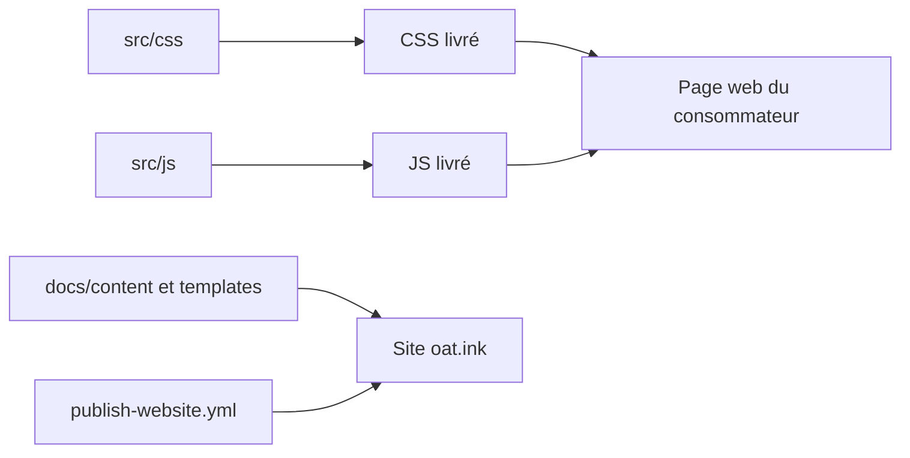

# knadh/oat

> Small dependency-free semantic HTML/CSS library for styling web pages without a framework.

## The problem
JavaScript UI libraries are heavy, full of dependencies and prone to license or API changes.

## What it actually does
Provides about 10 KB of CSS and JS: semantic tags and attributes are styled without classes. A few dynamic components (dropdown, tabs, toast, tooltip, sidebar) are WebComponents. Demo site and docs at oat.ink, generated by a static site generator and published by GitHub Actions.

## How it is wired


## Trying it
```bash
# Aucune commande documentée dans le README :
# inclure les fichiers CSS et JS, voir la démo sur oat.ink
```

## Cost and gotchas
Free, no build. Very short README: the file names to include and the customization procedure are not in the provided text.

## What it is not
Not a full kit like Bootstrap, nor a reactive framework. Suited to simple pages; rich application needs are not covered.

## Alternatives
- No alternative named in the README.

## For you
Ignore: it is minimalist front-end; for an ML demo dashboard it can help out, but it is not a data/AI topic.
