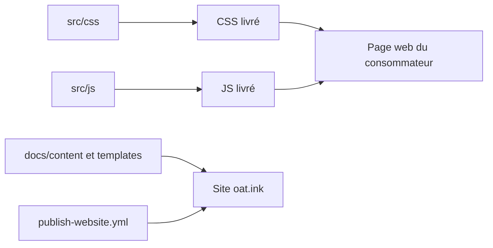

# knadh/oat

> Petite bibliothèque HTML/CSS sémantique sans dépendance pour styler des pages web sans framework.

## Le problème
Les bibliothèques d'UI JavaScript sont lourdes, pleines de dépendances et sujettes aux changements de licence ou d'API.

## Ce que ça fait vraiment
Fournit environ 10 Ko de CSS et JS : les balises et attributs sémantiques sont stylés sans classes. Quelques composants dynamiques (dropdown, tabs, toast, tooltip, sidebar) sont des WebComponents. Site de démo et docs sur oat.ink, générés par un générateur statique et publiés par GitHub Actions.

## Comment c'est branché


## Essayer
```bash
# Aucune commande documentée dans le README :
# inclure les fichiers CSS et JS, voir la démo sur oat.ink
```

## Coût et pièges
Gratuit, sans build. README très court : les noms de fichiers à inclure et la procédure de personnalisation ne sont pas dans le texte fourni.

## Ce que ce n'est pas
Pas un kit complet façon Bootstrap, ni un framework réactif. Convient à des pages simples ; les besoins d'application riche ne sont pas couverts.

## Alternatives
- Aucune alternative nommée dans le README.

## Pour toi
À ignorer : c'est du front minimaliste ; pour un tableau de bord de démo ML il peut dépanner, mais ce n'est pas un sujet data/IA.

