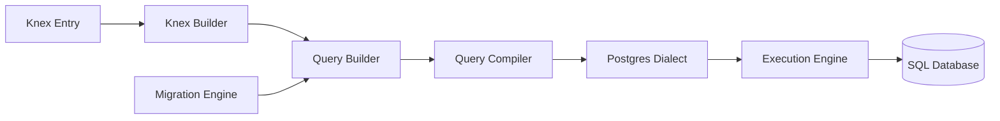

# knex/knex

> Multi-dialect SQL query builder for Node.js, with migrations and transactions.

## The problem
Writing raw SQL tied to a single engine complicates portability, schema migrations and dynamic query composition in JavaScript.

## What it actually does
Chainable API that builds queries, compiled to PostgreSQL, MySQL/MariaDB, CockroachDB, MSSQL, SQLite3 or Oracle.
Connection pool, transactions, streaming queries, promise and callback APIs.
Migration and seed engine via CLI.
TypeScript typing, ESM or CommonJS import.

## How it is wired


## Trying it
```bash
npm install
pip install setuptools
```
(Development setup commands; the README gives no explicit `npm install knex`.)

## Cost and gotchas
Free. Building `better-sqlite3` requires Python with `setuptools`, and on Windows the C++ Build Tools.

## What it is not
Not an ORM: for that the README points to other projects. Not a Python tool.

## Alternatives
- objection.js: ORM built on knex.
- mikro-orm: ORM based on knex.
- Bookshelf: historical ORM on knex.

## For you
Ignore: excellent in the Node ecosystem, but of no use in a Python data stack where SQLAlchemy fills that role.
