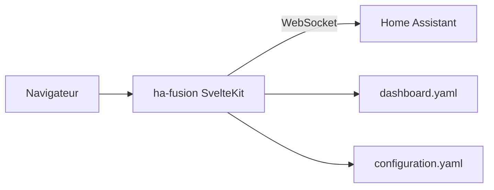

# knowald/ha-fusion

> Home Assistant dashboard in SvelteKit with a drag-and-drop editor, for home automation users.

## The problem
Home Assistant's default dashboards are mostly configured in YAML, by hand.

## What it actually does
It connects to Home Assistant over WebSocket and displays buttons, modal windows, sidebar widgets (weather, camera, charts) and a Spotify player. The layout is built by drag and drop and saved as YAML. Maintained continuation of the original by matt8707.

## How it is wired
Simplified diagram based on the sheet, no diagram provided.



## Trying it
```bash
docker compose up -d ha-fusion
docker run -d --name ha-fusion -p 5050:5050 -v /path/to/ha-fusion:/app/data -e HASS_URL=http://192.168.1.241:8123 ghcr.io/knowald/ha-fusion
```

## Cost and gotchas
A reachable Home Assistant instance is mandatory, with the `HASS_URL` variable. URL parameters do not work behind Ingress.

## What it is not
It is not a replacement for Home Assistant: it is an interface. The project points to a successor, Hearth.

## Alternatives
- Hearth: newer dashboard derived from this project.
- matt8707/ha-fusion: the original repository.

## For you
Ignore: home automation unrelated to data, AI or MLOps work.
