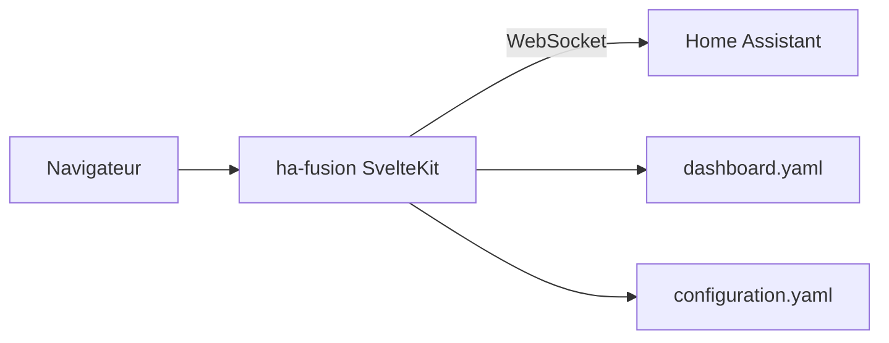

# knowald/ha-fusion

> Tableau de bord Home Assistant en SvelteKit avec éditeur par glisser-déposer, pour les utilisateurs de domotique.

## Le problème
Les tableaux de bord par défaut de Home Assistant se règlent surtout en YAML, à la main.

## Ce que ça fait vraiment
Il se connecte à Home Assistant par WebSocket et affiche boutons, fenêtres modales, widgets de barre latérale (météo, caméra, graphiques) et lecteur Spotify. La mise en page se construit par glisser-déposer et s'enregistre en YAML. Suite maintenue de l'original de matt8707.

## Comment c'est branché
Schéma simplifié d'après la fiche, sans diagramme fourni.



## Essayer
```bash
docker compose up -d ha-fusion
docker run -d --name ha-fusion -p 5050:5050 -v /path/to/ha-fusion:/app/data -e HASS_URL=http://192.168.1.241:8123 ghcr.io/knowald/ha-fusion
```

## Coût et pièges
Une instance Home Assistant joignable est obligatoire, avec la variable `HASS_URL`. Les paramètres d'URL ne marchent pas derrière Ingress.

## Ce que ce n'est pas
Ce n'est pas un remplacement de Home Assistant : c'est une interface. Le projet renvoie vers un successeur, Hearth.

## Alternatives
- Hearth : tableau de bord plus récent issu de ce projet.
- matt8707/ha-fusion : le dépôt original.

## Pour toi
Ignorer : domotique sans rapport avec un travail data, IA ou MLOps.

